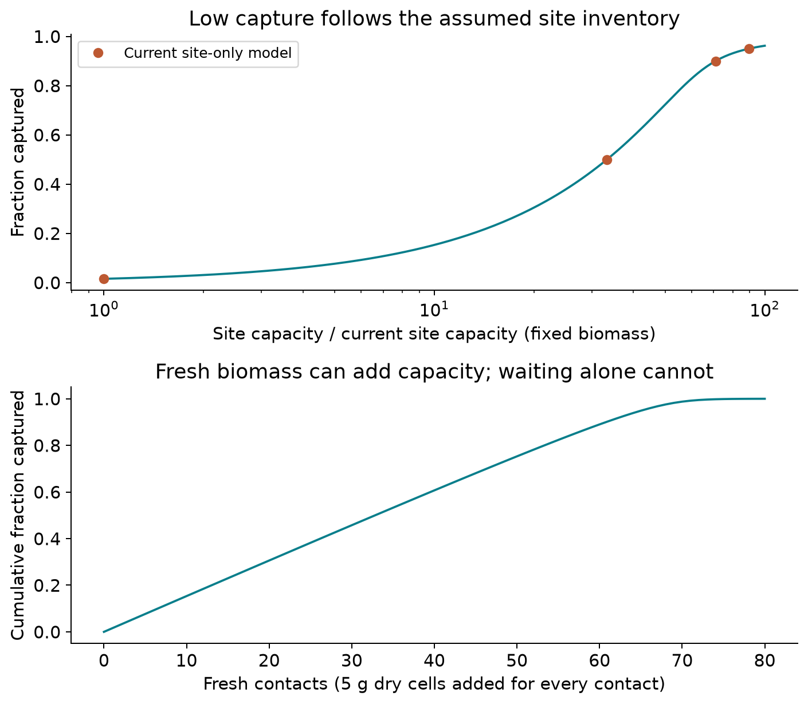

# Why capture is low: investigation of the recovery bottleneck

**Tier 3, synthesis.** Findings for the modelling and wet-lab teams, 2026-09-07.
This distinguishes a verified single-site calculation from unmeasured whole-cell
performance; it is not a calibrated process prediction.

## Finding

The arithmetic is correct, but the interpretation was too broad. The current
model counts one gold ion per accessible GolB site. That constrains static
occupancy, not necessarily all gold that growing engineered cells accumulate.
The earlier report should not have presented this number as an established
whole-cell capacity ceiling.

For the reference 1 L feed:

| Step | Gold amount |
|---|---:|
| Fed | 29 µmol |
| Bound in the single-occupancy model | 0.454974 µmol |
| Eluted | 0.365379 µmol |
| New metal, reference reduction kinetics | 0.365379 µmol |

The large loss occurs before reduction. The captured amount is about 1.57% of
feed, and the new metal about 1.26%. These are modelled fractions, not measured
process efficiencies.

## The capacity calculation

The expression model supplies 23,301 accessible sites/cell. Multiplying by
2.36×10¹² cells/g dry biomass, dividing by the Avogadro constant and converting
to µmol gives 0.0913135 µmol/g dry cells. At 5 g dry biomass, there are 0.456568
µmol of sites. The binding calculation occupies 99.651% of them.

Consequently, stronger affinity or extra waiting offers little improvement in
this particular calculation. The model is already at equilibrium. Recirculating
the liquid past the same saturated sites does not add capacity. Dilution at fixed
total biomass also does not create sites. Maintaining the same biomass
concentration while increasing volume would add biomass, which is a different
comparison.

## The missing distinction: whole-cell accumulation

[Wei et al. (2012)](https://doi.org/10.1039/C 2SC 01119K) report a whole-cell
loading of 4.62 µmol/g dry cells for surface-displayed GolB, about 51 times the
model's single-occupancy value. The units were checked visually in the
[original paper](source/capture_investigation/wei_2012_golb.pdf), printed page 1783.

This was an endpoint during overnight growth with Au(III) chloride in LB,
not a measured saturation capacity for our Au(I)-thiosulfate liquor. Cell-associated
particles were also observed. Thus total associated gold cannot automatically
be equated to isolated binding-pocket occupancy. Deposition, background binding,
and production of additional sites are possible contributors, not quantified
mechanisms in our model.

For scale only, that published loading on 5 g dry cells would correspond to
23.1 µmol of associated gold. It does not predict our recovery percentage.
Nor does it establish that all associated gold is available to our chosen
elution/reduction route. The phases and transfer fractions would need measuring.

## What a useful capture target requires

Let feed amount be n in µmol, capture volume V in L, dissociation constant Kd
in µmol/L, and desired captured fraction f. Inverting the existing equilibrium
law gives required site amount n_sites = f*n + Kd*V*f/(1-f).

| Target capture | Required capacity at 5 g dry cells | Required dry biomass at current capacity |
|---|---:|---:|
| 50% | 2.92 µmol/g | 159.9 g |
| 90% | 5.40 µmol/g | 295.7 g |
| 95% | 5.89 µmol/g | 322.5 g |

These are single-occupancy sizing calculations for 29 µmol feed in 1 L with
Kd=0.1 µmol/L. They are not recommendations to operate extremely dense cell
slurries. The 90% target would require roughly 59 times the current site capacity.
The literature loading shows why testing whole-cell accumulation is more
informative than assuming every improvement must come from extra displayed sites.

Fresh equilibrium contacts illustrate the resource trade-off:58 contacts with
5 g new dry cells each cross 90% capture, using 290 g total dry cells. Reuse could
reduce fresh biomass demand only if gold removal restores useful capacity.
No reuse lifetime or regeneration efficiency has been assumed here.

## What the published capacities give at the operating feed

Added 2026-09-07, [ISSUES 92](ISSUES.md). Three published whole-cell loadings
now sit in [capture_design.yaml](../params/capture_design.yaml) under
`literature:`, each with its measurement conditions. **None of them is adopted.**
`whole_cell_capacity` stays null. They are run as scenarios only, through the
same equilibrium the model already uses, at 29 µM gold, 5 g/L dry cells and
K_Au = 0.7 µM in 1 L.

| Capacity, µmol/g | Source | Captured, µmol | % of feed | Site occupancy | New metal, % of feed |
|---:|---|---:|---:|---:|---:|
| 0.0913 | this model, derived from expression | 0.4456 | 1.54 % | 97.61 % | 1.23 % |
| 4.62 | [S76](SOURCES.md), GolB on *E. coli* | 21.1981 | 73.10 % | 91.77 % | 58.70 % |
| 5.2 | [S77](SOURCES.md), GolB on *B. subtilis* | 23.2000 | 80.00 % | 89.23 % | 64.25 % |
| 329 | [S57](SOURCES.md), wild-type cells, Qe | 28.9874 | 99.96 % | 1.76 % | 80.28 % |
| 992 | [S57](SOURCES.md), Langmuir maximum | 28.9959 | 99.99 % | 0.58 % | 80.30 % |

Every capacity in that table was measured in a different gold chemistry.
S76 and S77 used Au(III) chloride during growth; S57 used Au(III) chloride at
pH 3 on wild-type cells. This project runs Au(I) thiosulfate at pH 9 to 10.
Nothing licenses the transfer, and [ISSUES 44](ISSUES.md) stands in front of all
of it: the leach makes 47 mM of tetrathionate, which blocks the cysteines the
binding depends on, and no scenario in the table contains that.

Two readings survive the caveat, because they concern the shape of the table
rather than its values:

1. **Capture stops being the bottleneck between 4.62 and 329 µmol/g.** At both
   GolB loadings the sites are still above 97 % occupied, so the sorbent is
   still the limit. By 329 µmol/g occupancy has fallen to 1.76 % and the feed is
   exhausted instead.
2. **80.31 % is the ceiling of the whole table**, and it is the 6 h elution
   efficiency, not capture. Once capacity is adequate the binding constraint
   becomes the unchosen eluent, [ISSUES 28](ISSUES.md).

The second reading is the useful one for planning. Raising capacity alone moves
the project from a capture-limited process to an elution-limited one, and the
eluent decision is already open and already cheap to make.

## Consequence for the model and next measurement

Keep the expression calculation as a single-occupancy reference. Measure total
whole-cell loading in the actual capture liquid, using displayed, undisplayed
and binding-deficient controls at known dry biomass. The five-step isotherm
protocol is written out in [ISSUES 92](ISSUES.md), which also prices the four
assumptions inside the derived number. Quantify the remaining
soluble gold and distinguish bound ionic gold from deposited particles, then
measure what actually reaches the eluate. This separates additional accumulation
from loss of soluble gold by unrelated processes.

A project-matrix whole-cell capacity is now explicitly null in the parameter
file. It cannot be inferred by copying the published endpoint or increasing the
number until the desired yield appears. Biological processing is not shown to
be intrinsically ineffective by this scenario; the calculation exposed both an
undersized site-only design and an incomplete description of possible capture.

Reproduce the sizing and graph with
[make_capture_design_figures.py](make_capture_design_figures.py).
The tested equations are in [capture_design.py](../src/capture_design.py),
where `capacity_scenario` is the forward equilibrium that `required_site_amount`
inverts,
scenario targets in [capture_design.yaml](../params/capture_design.yaml), and
computed results in [capture_investigation.json](media/recovery_model/capture_investigation.json).
See [ISSUES 91](ISSUES.md) and [S 76](SOURCES.md) for the correction record.
