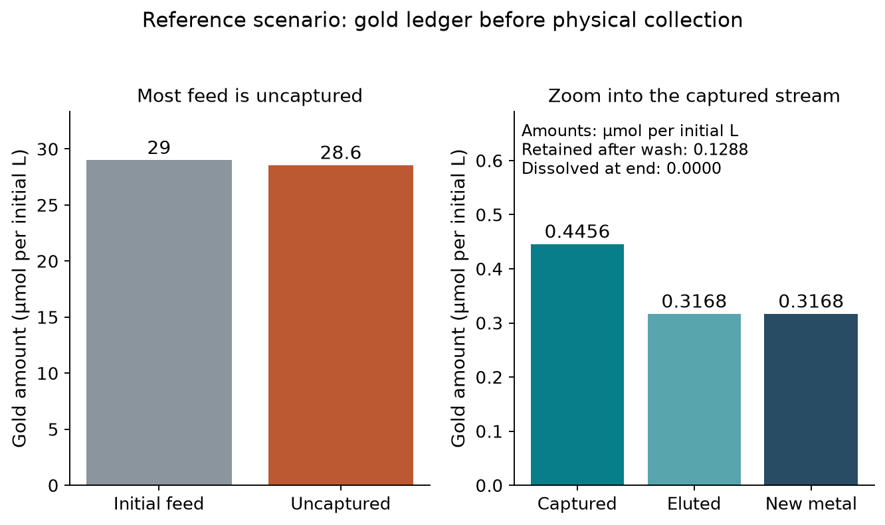
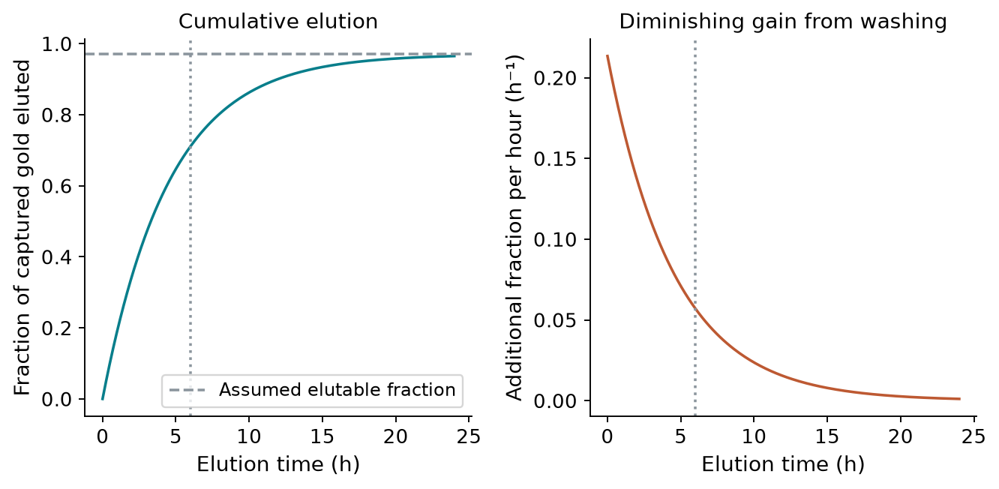
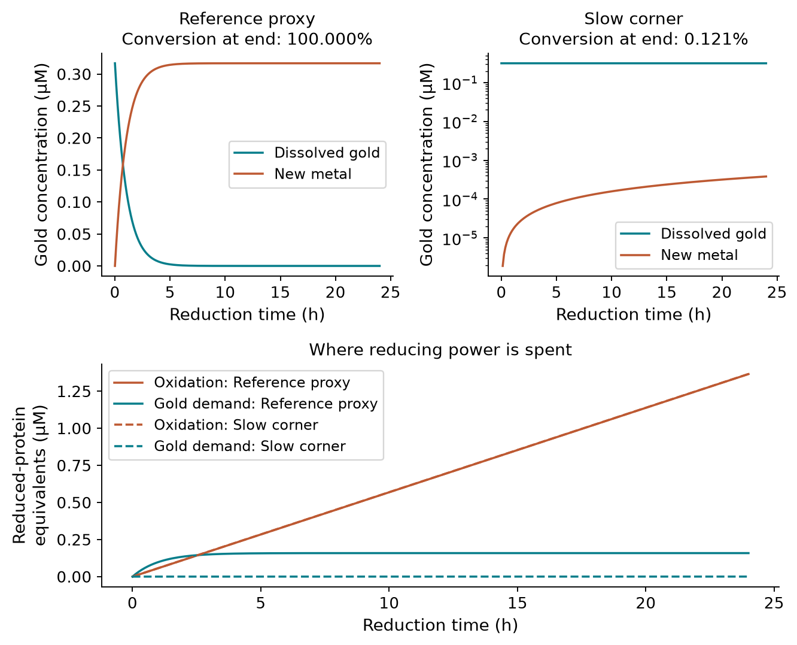
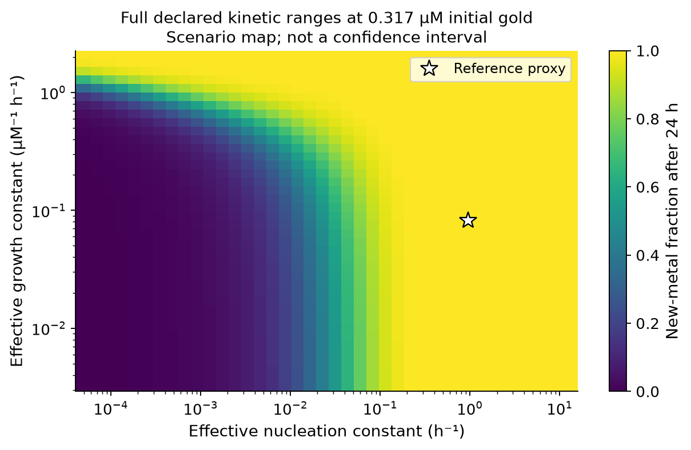
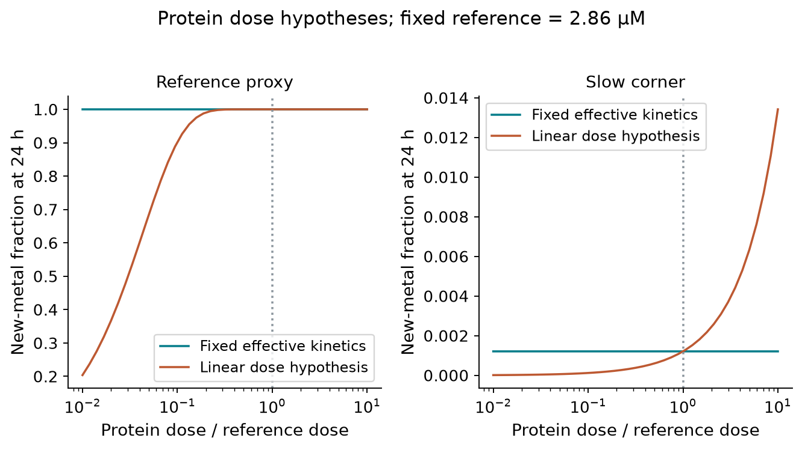

<!-- **Tier 4, generated.** Do not hand-edit. Built by build_recovery_model.py. Technical model report for the modelling and wet-lab teams. This is the current model and its conditional analysis, not a wiki page or experimental validation. Tables are populated from the parameter files by build_recovery_model.py. -->

# Purpose and principal result

This model follows dissolved gold through binding to GolB-displaying cells,
elution into a separate liquid, and reduction to metallic gold. Its purpose is
to identify process constraints, compare explicit operating scenarios, and
specify the measurements needed for prediction. The endpoint is **new metal
formed**, before physical collection; neither particle size nor product purity
is predicted.

The reference calculation is a **single-occupancy GolB-site model**, limited
primarily by its assumed binding-site inventory.
Even complete reduction cannot recover gold that remained in the capture
liquid. This site inventory is not a proven ceiling on total whole-cell gold
accumulation. A directly relevant surface-GolB study reports additional
whole-cell evidence that the earlier review missed; the
[capture investigation](CAPTURE_INVESTIGATION.md) explains the corrected scope
and the capacity measurements needed. However, the declared range of reduction kinetics also admits very low
conversion within the batch duration. The useful conclusion is therefore
conditional: improve and measure capture capacity, while measuring reduction
kinetics before relying on a high overall yield.

| Quantity | Reference | Slow kinetic scenario |
|---|---:|---:|
| Feed gold | 29 µmol | 29 µmol |
| Captured gold | 0.445643 µmol | 0.445643 µmol |
| Eluted gold | 0.316798 µmol | 0.316798 µmol |
| New metal after the reduction batch | 0.316798 µmol | 0.000383026 µmol |
| New metal / original feed | 1.092407% | 0.001321% |

These are simulated amounts, not measured recoveries. The reference uses a
1 L feed, 1 L capture liquid and 1 L eluate, with protein supplied separately
at the specified final concentration and negligible added volume. These volumes
are an explicit reporting basis, not a proposed vessel specification. The slow
scenario changes both reduction rate constants to the lower ends of their
recorded ranges and leaves every other input unchanged.

# 1. Process accounting and capture

The model carries **amounts between stages and concentrations within each
vessel**. Let the feed concentration be $A_f$ in µmol/L and its volume be $V_f$
in L. The initial gold amount is $n_f=A_fV_f$ in µmol. If the capture volume
is $V_c$ in L, its total gold concentration is $A_T=n_f/V_c$. A different volume
does not itself create or remove gold; any concentration operation represented
this way assumes quantitative transfer and has no modelled cost or loss.

The dry capture biomass is $m_X$ in g. Its specific binding capacity is $q$ in
µmol/g, giving a site concentration $S=qm_X/V_c$ in µmol/L. The capacity is
recomputed from the upstream expression model through the interface function,
rather than copied as an independent input. It assumes accessible, functional
binding sites and the adopted binding stoichiometry. Expression therefore gives
a conditional single-occupancy capacity, not total whole-cell accumulation or
proof of activity in real leachate. Whole-cell capacity in the project matrix
remains unmeasured; it is represented explicitly by a null parameter.

Let $K_d$ be the gold dissociation constant in µmol/L and $C$ the bound gold
concentration in µmol/L. Equilibrium binding and conservation require

$$C=\frac{S(A_T-C)}{K_d+A_T-C}.$$

The implemented, numerically stable solution is

$$C=\frac{2SA_T}{S+K_d+A_T+
\sqrt{(A_T-S)^2+K_d[K_d+2(A_T+S)]}}.$$

The captured amount is $n_c=CV_c$ and the capture fraction is $n_c/n_f$.
The zero-feed case returns zero. This formulation prevents binding more gold
than was fed or more than the available sites can hold. In the capacity-limited
regime, the bound amount approaches $qm_X$; increasing affinity cannot overcome
that inventory ceiling. Diluting a fixed feed and fixed biomass is not equivalent
to increasing capacity, and may reduce binding by lowering free concentration.

This is an equilibrium calculation. It does not determine capture duration,
mass-transfer resistance, growth, death or site damage. In particular, binding
in a clean solution cannot establish binding in the upstream sulfur-containing
mixture. The unresolved leachate compatibility issue remains material
([ISSUES 44](ISSUES.md)); the uncalibrated damage coefficient is not replaced by
a guessed timing model.

# 2. Elution and mixing

Let $f_r$ be the fraction of bound gold that remains nonelutable, $k_e$ the
first-order elution rate in h⁻¹, and $t_e$ the wash duration in h. The eluted
fraction $\eta_e$ and eluted amount $n_e$ in µmol are:

$$\eta_e=(1-f_r)(1-e^{-k_et_e}),\qquad n_e=n_c\eta_e.$$

Its marginal gain is

$$\frac{d\eta_e}{dt_e}=(1-f_r)k_e e^{-k_et_e}.$$

This separates an assumed chemistry ceiling from the decreasing benefit of
additional elution time. The reference elution releases about 71.1% of captured
gold after 6 h; the assumed ceiling is 97%. Extending elution cannot overcome
that ceiling. A longer elution can be assessed against throughput and measured protein
stability, but the model does not assign an economic optimum.

Holding $k_e$ fixed while changing biomass, loading, elution chemistry or volume is an untested
transfer assumption. The sorption literature motivates this functional form;
it does not establish desorption kinetics for GolB cells. Fit competing forms
to an actual elution time course before choosing between them
([Ho and McKay, 1999](https://doi.org/10.1016/S0032-9592(98)00112-5);
[S62](SOURCES.md)).

Let the eluate volume be $V_e$ and the added lysate volume be $V_l$, both in L.
The reduction volume is $V_r=V_e+V_l$ and initial dissolved gold is
$A_0=n_e/V_r$ in µmol/L. If protein is supplied by lysate with concentration
$E_l$ in µmol/L, its final concentration is $E_T=E_lV_l/V_r$.
The program requires that lysate concentration explicitly. A target protein dose
is a separate supply mode; it does not assert that expression and lysis can
produce the target. The selected protein concentration is not total lysate
protein, and the model currently assumes that the specified protein is redox
competent.

# 3. Reduction: kinetics and reducing-capacity balance

Dissolved gold is $A$, total metallic gold is $B$, reduced protein is $E_r$,
oxidised protein is $E_o$, and recharge donor is $D$, all in µmol/L. Total
protein is conserved as $E_T=E_r+E_o$. Time is measured in h. Initial seed
metal concentration is $B_{seed}$ and initial donor concentration is $D_0$,
both in µmol/L. The initial conditions are $A=A_0$, $B=B_{seed}$, $D=D_0$, and, in the reference,
$E_r=E_T$. A partially reduced initial pool is also supported.

The effective nucleation constant is $k_n$ in h⁻¹ and the effective growth
constant is $k_g$ in L µmol⁻¹ h⁻¹. The dimensionless protein-availability
factor is $g_E$, defined below. The reaction rate $v$ in µmol L⁻¹ h⁻¹ is

$$v=(k_n+k_gB)A\,g_E.$$

The two terms describe nucleation and autocatalytic growth. This is a
Finke–Watzky-inspired reduced description, not a resolved enzyme mechanism or
a particle population model. Its original experimental basis differs from this
protein and gold complex
([Watzky and Finke, 1997](https://doi.org/10.1021/ja9705102)).
Metal concentration serves as an effective growth proxy; particle surface area,
size and aggregation are not resolved. Seeded predictions consequently require
seed-specific calibration.

In the default model, the protein factor is $g_E=E_r/E_T$, with zero reaction
when no protein is present. The constants are effective rates held fixed as
protein dose changes. A second, explicitly hypothetical option uses
$g_E=E_r/E_{ref}$, where $E_{ref}$ is a fixed reference protein concentration.
It assumes both rate terms scale linearly with available reduced protein.
The alternatives agree at the reference dose, but need not agree elsewhere.
Neither should be used as an established enzyme-dose law.

The protein recharge constant is $k_c$ in L µmol⁻¹ h⁻¹, the gold inhibition
constant is $K_i$ in µmol/L, and the protein oxidation constant is $k_o$ in h⁻¹.
The recharge rate is

$$v_c=\frac{k_c E_oD}{1+A/K_i}.$$

Let $\nu$ be protein reducing equivalents consumed per gold atom reduced, and
$\rho$ the donor molecules consumed per protein equivalent recharged. The
state equations are

$$\dot A=-v,\quad \dot B=v,\quad
\dot E_r=-\nu v+v_c-k_oE_r,\quad
\dot D=-\rho v_c.$$

The reference stoichiometry assumes one two-electron protein equivalent and
one two-electron donor equivalent. Thus $\nu=0.5$ mol/mol for Au(I) and
$\rho=1$ mol/mol. This is bookkeeping based on the proposed redox mechanism,
not a measured coupling efficiency. The precursor oxidation state and recharge
yield need confirmation. Protein oxidation consumes reducing capacity here;
it does not redissolve metallic gold. Direct reduction by dithionite, donor
decomposition, irreversible protein inactivation and competing electron sinks
are not separately represented.

To check reducing capacity, the model integrates cumulative oxidation loss
$L$ in µmol/L of protein equivalents using $\dot L=k_oE_r$. Every trajectory
must satisfy the following identities, where $E_{r,0}$ is the initial reduced
protein concentration in µmol/L:

$$A+B=A_0+B_{seed},$$

$$E_r+\frac{D}{\rho}+\nu(B-B_{seed})+L
=E_{r,0}+\frac{D_0}{\rho}.$$

The second identity is an electron balance expressed in protein equivalents.
The reduction fraction $\eta_r$ has the rate-independent ceiling

$$\eta_r\leq\min\left(1,
\frac{E_{r,0}+D_0/\rho}{\nu A_0}\right).$$

Oxidation can make the attainable conversion lower than this ceiling. Newly
formed metal is $(B-B_{seed})V_r$, so seed is never counted as product.
The solver checks finite states, physical bounds and both balances; it returns
the integrated values without clipping an invalid output into the allowed range.

# 4. Inputs and what supports them

| Clear name (existing symbol) | Reference value | Evidence |
|---|---:|---|
| Feed gold concentration (`Au_feed`) | 29 µmol/L | Reporting scenario; recovery_audit.yaml |
| Single-occupancy binding capacity (`q_max`) | 0.0913135 µmol/g | Derived expression joint; ISSUES 62 |
| Reference biomass concentration (`X_max`) | 5 g/L | Operating assumption |
| Gold dissociation constant (`K_Au`) | 0.7 µmol/L | GolB-based literature proxy; S78, ISSUES 1 |
| Nonelutable fraction (`phi`) | 0.03 fraction | Transferred assumption; ISSUES 28 |
| First-order elution rate (`k_elute`) | 0.22 h⁻¹ | Acid-thiourea lower-bound proxy; S60 |
| Elution time (`t_elute_h`) | 6 h | Reporting time |
| Effective nucleation rate (`k_nuc`) | 0.96 h⁻¹ | Cross-system proxy; S74, ISSUES 84 |
| Effective autocatalytic growth rate (`k_grow`) | 0.082 L µmol⁻¹ h⁻¹ | Cross-system proxy; ISSUES 84 |
| Protein oxidation rate (`k_ox`) | 0.02 h⁻¹ | Unmeasured assumption |
| Protein recharge rate (`k_rech`) | 0.1 L µmol⁻¹ h⁻¹ | Unmeasured assumption |
| Gold inhibition constant (`K_inh`) | 500 µmol/L | Unmeasured assumption |
| Initial recharge donor (`Rech_0`) | 50 µmol/L | Design choice; S35 gives reagent identity |
| Final redox-protein concentration (`E_tot`) | 2.85714 µmol/L | Target dose, not measured supply |
| Protein equivalents per gold (`nu`) | 0.5 mol/mol | Proposed two-electron mechanism; S63 |
| Donor per protein recharge (`nu_rech`) | 1 mol/mol | Assumed coupling; ISSUES 90 |
| Reduction duration (`t_reduce_h`) | 24 h | Design choice |
| Nucleation scenario range | 5e-05–14 h⁻¹ | Declared scenarios; not a confidence interval |
| Growth scenario range | 0.0032–2.1 L µmol⁻¹ h⁻¹ | Declared scenarios; not a confidence interval |

Clear names describe each parameter's role; the existing symbols remain in the
parameter files for reproducibility. Those files now include descriptive names,
units and evidence notes. The public process interface uses names such as
`feed_gold_concentration_uM`, `biomass_mass_g`, `elution_volume_L`,
`nucleation_rate_per_h` and `final_protein_concentration_uM`.

The nucleation reference is a cross-system enzyme proxy, not a measurement of
particle formation by the selected protein. The growth constant is also
transferred from other chemistry. Their recorded intervals are scenario ranges,
not probability distributions. Calling an input insensitive at one operating
point does not establish its value or justify omitting its uncertainty.
All primary-source mappings and qualifications are retained in
[SOURCES.md](SOURCES.md), especially S35, S39, S62–S75.

# 5. What the analyses establish

The reference reaches essentially complete conversion of the small eluate
inventory within 24 h. The slow corner converts about 0.121% of that inventory
within 24 h. A sufficient donor inventory therefore does not establish a
sufficient reaction rate. In the reference trajectory, gold reduction consumes
about 0.183 µmol/L of protein reducing equivalents, whereas the assumed
oxidation route consumes about 1.37 µmol/L over 24 h. This comparison exposes
the consequence of the assumed oxidation constant; it is not a measured loss
or evidence for a particular oxygen-control strategy. The full kinetic map shows where that distinction
matters while holding feed, protein, donor and batch duration fixed.

At the reference capture capacity, even ideal elution and reduction cannot
exceed the captured fraction of the feed. Under the assumed elution ceiling,
the achievable amount is lower still. These inventory limits remain useful
before kinetics are calibrated. In contrast, an assertion that reduction is
always unimportant is contradicted by the slow scenario.

A nearly flat response at a saturated endpoint cannot establish that protein
has no kinetic effect. Nor can increasing protein be justified by a simulation
that normalises away its rate dependence. The dose comparison makes this
structural uncertainty visible. Early time courses at different doses would
be more informative than complete-conversion endpoints alone.

The useful design priorities are therefore to measure functional capture
capacity in the actual liquid, establish an elution time course, and determine
whether the reduction trace is compatible with the assumed kinetic and
protein-dose forms. Seed addition and concentrating eluate can then be tested
as conditional changes, with added seed and liquid volumes fully accounted for.
The model does not yet demonstrate an optimum for either intervention.

# 6. Calibration, verification and remaining limits

Calibration should measure the same quantities that the equations represent.
For capture, quantify feed and remaining soluble gold at known biomass and
volume, including a control without displayed binding protein. For elution,
measure gold in the wash and remaining with the biomass over time. For
reduction, quantify dissolved gold and independently establish metallic product;
include protein-free, donor-free and inactive-protein controls to distinguish
chemical reduction and nonspecific loss from the proposed protein route.

The existing fitter accepts calibrated absolute concentrations. It never forces
the largest observed signal to mean complete conversion. A single optical
signal is not automatically metallic gold concentration because particle
properties affect extinction ([S75](SOURCES.md)). Dissolved-gold disappearance
is also insufficient if adsorption or other losses are unaccounted for.
The available closed-form fitter assumes donor excess and no seed; traces with
substantial donor depletion or seeding require fitting the full trajectory
model. Fitted covariance alone does not cover uncertain chemistry or parameter
transfer. Reserve independent conditions for prediction checks and examine
residuals rather than relying only on a fit score.

Computational verification covers capture inventory limits, very dilute feeds,
the independent donor-excess closed form, zero-rate and zero-protein limits,
seed subtraction, donor starvation, gold and reducing-capacity conservation,
volume changes, lysate dilution and calibrated incomplete-trace fitting.
The protein-yield helper also refuses harvest times outside the simulated
window. These checks establish implementation consistency, not experimental
accuracy.

The implemented model can now support transparent scenario analysis. Its main
remaining uncertainties are functional sites in real leachate, elution kinetics,
active protein supply, precursor chemistry and reduction-rate transfer. Those
uncertainties must stay attached to the results until measurements replace
the proxies. The upstream biological feasibility issues remain outside this
recovery calculation; a successful downstream simulation does not resolve them.

# Reproducibility

The model is implemented in [recovery_process.py](../src/recovery_process.py),
[recovery_chain.py](../src/recovery_chain.py) and
[reduction.py](../src/reduction.py). Parameter values and scenario volumes live
in [recovery_chain.yaml](../params/recovery_chain.yaml),
[recovery_audit.yaml](../params/recovery_audit.yaml) and
[recovery_process.yaml](../params/recovery_process.yaml). The expression joint
is recomputed on every reference run.

Run [build_recovery_model.py](build_recovery_model.py) with `--figures` to
regenerate this report, its numerical tables and figures. The machine-readable
figure results are [results.json](media/recovery_model/results.json).
The earlier [recovery review](RECOVERY.md) and [ISSUES 84–90](ISSUES.md) preserve
the audit trail; this report presents the current model rather than that history.
