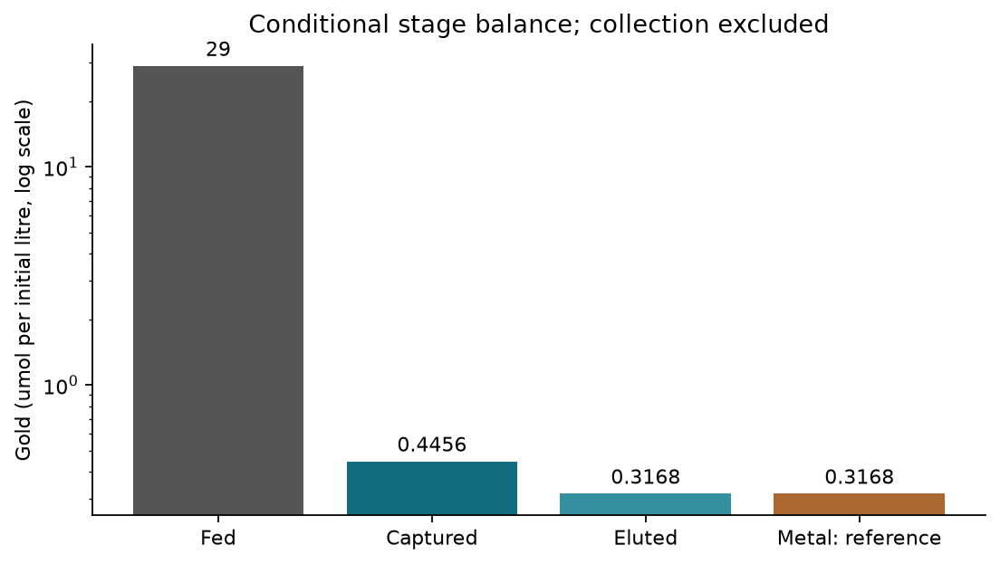
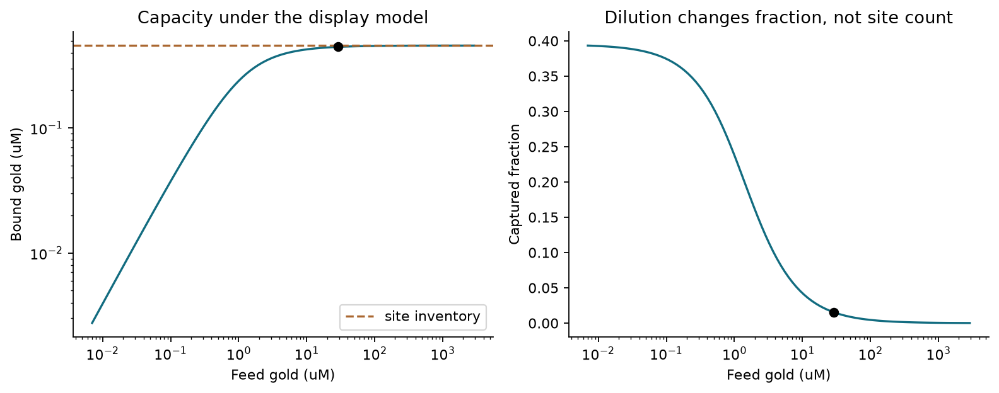
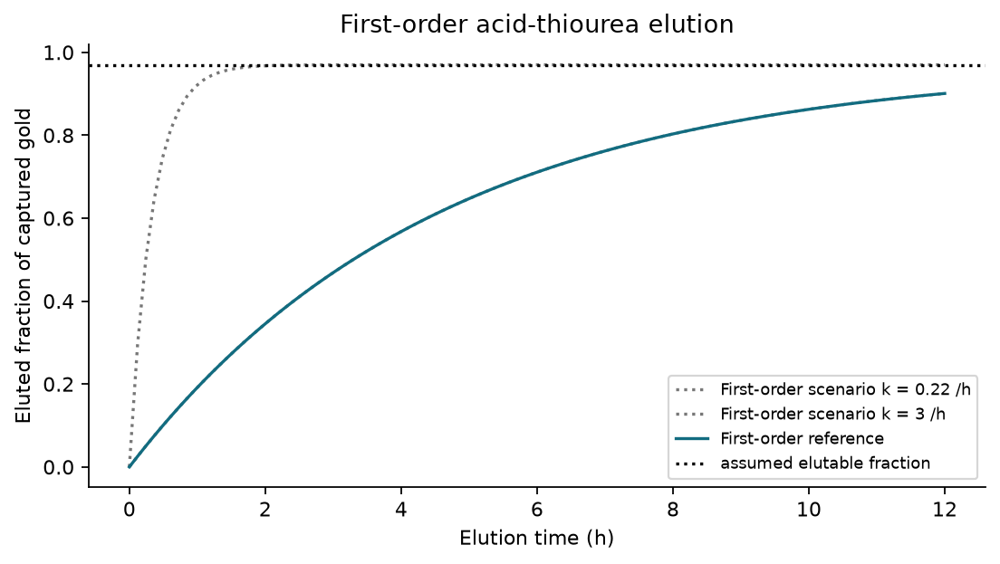
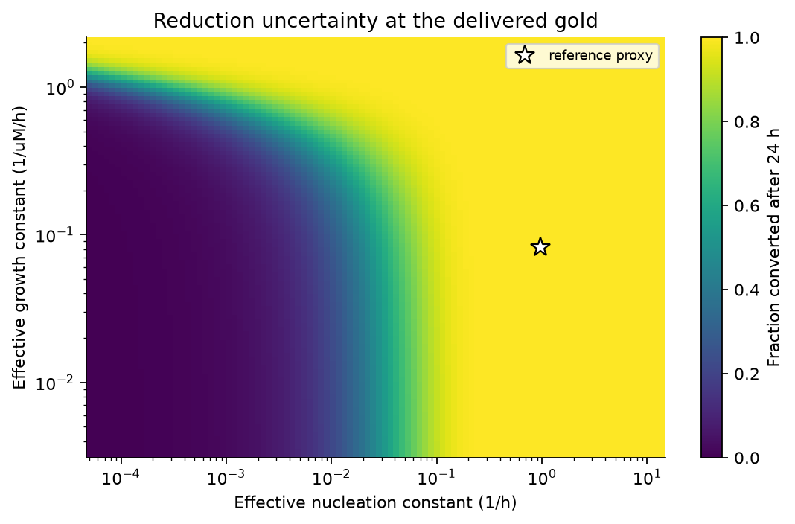

<!-- **Tier 4, generated.** Written by docs/build_recovery.py from RECOVERY.md. Do not hand-edit: every run overwrites it. -->

**Tier 3, synthesis.** Technical review for the recovery modeller and wet-lab
team. This report describes the implemented model, its verification and the
measurements it still needs. It is not evidence of experimental recovery.
Built to [RECOVERY.docx](RECOVERY.docx). Source documents remain unchanged.

# 1. Review verdict

**The staged approach is useful for iGEM, but its output is a conditional
scenario, not yet an accurate prediction of the working process.** Conservation,
stage interfaces and sensitivity analysis are the right tools. The main defect
was treating borrowed kinetics and a passing test suite as stronger evidence
than they are. The model is valuable when it shows what needs measuring and
which decisions depend on those measurements.

The audit corrected the curve fitter, uncertainty runner, rank handling,
low-concentration equilibrium calculation and protein dilution equation.
It also withdrew unsupported harvest recommendations and the claim that
reduction uncertainty does not matter. The decisions and original conclusions
are preserved in [ISSUES.md](ISSUES.md), items 84–89.

| Finding | Consequence | Treatment |
|---|---|---|
| Reduction kinetics come from different systems and mechanisms | Complete conversion is not established | Keep the nominal case and show the full declared kinetic range |
| Observed maximum was forced to complete conversion by the fitter | An incomplete trace could give misleading fitted rates | Fit calibrated concentrations without rescaling the maximum |
| Protein dilution continued at stationary biomass | Reported yield and harvest time were inconsistent with the growth equation | Use actual specific growth; withdraw the old optimum |
| Sensitivity runner requested a removed stage and mishandled equal ranks | The existing suite missed execution and statistical failures | Add regression checks and correct both paths |
| Death coefficient had the wrong time dimension | Growth-and-damage capture timing was not defensible | Leave its replacement null; remove that harvest recommendation |
| The reported final quantity excluded collection and volume changes | “Recovered gold” could imply more than was computed | Report metal formed per initial litre under explicit transfer assumptions |

```{=openxml}
<w:p><w:r><w:br w:type="page"/></w:r></w:p>
```

# 2. Scope and mass balance

The boundary begins with dissolved gold supplied by the leach and ends with
gold assigned to the metallic state. Leaching and GolB expression are inputs
to this part; physical collection is outside it. Their uncertainties and
compatibility still affect whether the process works.

Write the capture efficiency as $\eta_c$, the fraction of captured gold eluted
as $\eta_e$, and the fraction of eluate gold reduced as $\eta_r$. Their product
is the fraction of feed gold converted to metal:

$$\eta_{metal}=\eta_c\eta_e\eta_r.$$

This multiplication is valid for **amount fractions**. The reference calculation
assumes equal stage volumes, quantitative transfers and separately supplied
protein at the target concentration. If washing or lysate addition changes
volume, calculate the next concentration from transferred amount divided by
actual volume. Dilution alone cannot create gold or extra binding sites.

The report scenario uses a feed of 29 µM, biomass of 5 g dry weight/L,
a wash of 6 h and a reduction batch of 24 h. These are scenario settings in
[recovery_audit.yaml](../params/recovery_audit.yaml), not new measurements.
The other parameters come from [recovery_chain.yaml](../params/recovery_chain.yaml).

| Stage | Gold amount per initial litre | Fraction of the preceding stage |
|---|---|---|
| Feed | 29 µmol/L | Reference input |
| Captured | 0.45497 µmol/L | 1.5689 % |
| Eluted | 0.36538 µmol/L | 80.3077 % |
| Metal, reference kinetics | 0.36538 µmol/L | Approximately 100 % |

The reference total is **1.2599 % of feed gold**. Under the slow corner of
both declared kinetic ranges, reduction is only **0.1211 %** of the eluate;
metal output falls to approximately **0.000443 µmol per initial litre**.
This is a scenario comparison, not a confidence interval. Unknown chemistry
can also fail outside this selected range.



Every value in this table is reproducible through
`src/recovery_audit.py::stage_amounts`; the plotted grid and inputs are recorded
in [audit_results.json](media/recovery/audit_results.json).

```{=openxml}
<w:p><w:r><w:br w:type="page"/></w:r></w:p>
```

# 3. Capture: the strongest part of the approach

## 3.1 Equilibrium is a useful first calculation

Let total gold concentration be $A_T$, free gold be $A$, bound gold be $C$,
and available site concentration be $S$. The display capacity per dry biomass
is $q_{max}$ and biomass is $X$, so $S=q_{max}X$. The apparent dissociation
constant is $K_{Au}$. Conservation and the Langmuir isotherm give:

$$A=A_T-C,\qquad C=\frac{S A}{K_{Au}+A}.$$

Substitution gives a quadratic. For $b=S+K_{Au}+A_T$, the physical root is
most stably evaluated as:

$$C=\frac{2SA_T}{b+\sqrt{(A_T-S)^2+K_{Au}(K_{Au}+2A_T+2S)}}.$$

It conserves gold and never binds more than the site inventory. The rationalised
form avoids subtracting nearly equal numbers at very low feed. Zero feed has
zero bound gold and a reporting convention of zero captured fraction.

The display cascade is recomputed through Joint 2, rather than copying a site
count into the figure. It gives $q_{max}=0.0913135$ µmol/g and $S=0.456568$ µM
at the reference biomass. The apparent affinity remains $K_{Au}=0.1$ µM,
by the standing decision in [ISSUES.md](ISSUES.md), item 1.



At this feed, predicted occupancy is nearly complete and **capacity is the
constraint within the GolB-only model**. Increasing biomass or active display
is therefore worth testing. This is not proof that those changes will work
proportionally in the real vessel. The capacity is derived, not measured;
background cell adsorption is excluded, and surface accessibility, folding,
speciation, competition and transport may alter the response. Item 69 records
why background adsorption needs a control.

At low feed, the captured fraction approaches $S/(K_{Au}+S)$, rather than
necessarily reaching unity. A lower feed improves the fraction but does not
establish greater throughput per original volume. A fair dilution comparison
must keep gold amount and total biomass accounted for.

## 3.2 What must be measured before recommending a harvest

The previous growth-and-damage calculation used a death coefficient with units
inconsistent with its damage state. Several repairs are dimensionally possible;
none is uniquely supported. The replacement remains null. The previously
recommended capture harvest time is withdrawn, and its timing plots are not
part of this report. See items 73 and 88.

Use binding curves and endpoints for engineered cells, unmodified cells and
a cell-free blank, in both simple gold solution and representative leachate.
Measure dissolved and cell-associated gold, biomass and viability. This tests
capacity, apparent affinity, transport and matrix effects without presuming
that loss from solution means GolB binding. Polythionate/copper compatibility
remains an upstream-interface concern, especially items 44 and 60.

```{=openxml}
<w:p><w:r><w:br w:type="page"/></w:r></w:p>
```

# 4. Elution: a provisional first-order release model

Let $C_0$ be the gold actually bound at harvest and $\phi$ the residual fraction
that the chosen empirical model never elutes. Let $U$ be the remaining elutable
loading. The first-order candidate is:

$$U(0)=(1-\phi)C_0,\qquad \frac{dU}{dt}=-k_{elute}U,$$

$$\eta_e=(1-\phi)(1-e^{-k_{elute}t}).$$

The reference uses $\phi=0.03$ and $k_{elute}=0.22$ h⁻¹; its 6 h elution
releases 71.1 % of bound gold. Both values come from S60 under 0.1 M thiourea,
0.1 M sulfuric acid, 50 °C and 1 g sorbent/L. They are not measurements on
GolB.

**First order is a provisional simplification, not proof of a molecular
mechanism.** It avoids making the working rate depend on initial gold loading,
but must still be fitted to the project comb under the selected wash chemistry.



The useful communication is that the recoverable fraction and the approach to
it answer different questions. For the reference, 95 % of its ceiling requires
13.6 h; waiting cannot exceed that assumed ceiling. However, a flat
experimental trace could also reflect reagent depletion, inactivation or
measurement limits. It does not by itself establish an irreversible fraction.

Fit first-order and PSO alternatives to the same measured time course using
residuals and withheld observations. Repeat at different loadings. Test actual
eluate compatibility with the reduction step: improving desorption alone is
not necessarily an improvement in total metal formed. The thesis-level
mechanistic detail can stay in the technical report; the wiki needs this
trade-off, the measured curve when available, and its design consequence.

```{=openxml}
<w:p><w:r><w:br w:type="page"/></w:r></w:p>
```

# 5. Reduction: the largest unresolved scientific claim

## 5.1 What the implemented model says

Let dissolved gold be $A$, metallic gold be $B$, reduced protein be $E_r$,
total protein be $E_T$, and dithionite be $R_d$. The spent protein is
$E_o=E_T-E_r$. Effective nucleation and growth constants are $k_n$ and $k_g$.
The implemented rate and balances are:

$$v=(k_n+k_g B)A\frac{E_r}{E_T},\qquad \dot A=-v,\quad \dot B=v,$$

$$v_{rech}=\frac{k_{rech}E_oR_d}{1+A/K_{inh}},$$

$$\dot E_r=-\nu v+v_{rech}-k_{ox}E_r,\qquad
\dot R_d=-\nu_{rech}v_{rech}.$$

The recharge constant is 0.1 µM⁻¹ h⁻¹ and the inhibition scale is 500 µM.
The protein oxidation constant is 0.02 h⁻¹; **it does not represent gold
reoxidation**. The model assumes initially reduced protein. Its disulfide
cycle and direct recharge are hypotheses. The methyl-viologen mediator used
in the source experiment has no kinetic equation here. See items 49 and 88.

If seed particles are added, conversion counts only newly formed metal:

$$\eta_r=\frac{B(t)-B(0)}{A(0)}.$$

The electron ledger is an upper bound, not a conversion prediction. Under the
assumed two-electron protein/dithionite bookkeeping and one electron per Au(I):

$$\eta_r\leq\min\left(1,\frac{2E_T+2R_d(0)}{A(0)}\right).$$

Oxygen losses and incomplete availability can reduce what is achieved. The
reference protein target is 0.2 g/L, or approximately 2.857 µM, and dithionite
is 50 µM. The nominal electron inventory is ample, but does not demonstrate
that electrons reach Au(I)-thiourea or that recoverable particles form.

## 5.2 Why the reference rate is not validation

The source experiment [S35](SOURCES.md) uses the project's protein with
Au(III). The reference $k_n=0.96$ h⁻¹ instead borrows an electron-transfer
estimate from a different enzyme, MerA, and uses it as particle nucleation.
That transfer changes enzyme, precursor, medium and observable. It is not a
measured rate for this recovery vessel. The detailed S74 kinetics table was
not independently accessible in this audit; the repository's earlier source
record is retained with that limitation.

The code also keeps these effective constants fixed when protein is varied.
It therefore does not implement a general enzyme-dose dependence. Claims
that increasing protein is useless, or that lowering the protein target is
safe, cannot be established from that sweep alone.

For donor excess and no seed, the closed form can check the integration.
With $R=k_g A(0)/k_n$, the time to a fraction $f$ is:

$$t_f=\frac{\ln((1+fR)/(1-f))}{k_n+k_g A(0)}.$$

Autocatalytic growth overtakes nucleation only if $R>1$; the exact crossing
uses $f=1/R$ in that expression. The shortcut $1/(k_gA(0))$ is not the exact
crossing time. At the reference proxy the delivered gold reaches 95 % in
about 3.1 h under donor excess. That is conditional mathematics, not a
validated batch-duration recommendation.

## 5.3 Show the full range

The declared nucleation range is 5.0e-5–14.0 h⁻¹; the growth range is
0.0032–2.1 µM⁻¹ h⁻¹. These combine different literature/proxy scenarios and
are not measured bounds on this protein. Their rectangular combination is a
stress test, not an inferred joint distribution.



The slow corner gives 0.1211 % reduction while the reference is effectively
complete. **Reduction uncertainty cannot be dismissed.** The old tornado
sampled a much narrower range around the reference, masking this conclusion.
Its generator now reads both full kinetic ranges. One-at-a-time bar lengths
still depend on the ranges chosen and cannot be ranked as universal biological
importance. A zero effect upstream can also mean that a pathway was omitted,
not that it is harmless.

## 5.4 A valid measurement-and-fitting loop

Measure in the actual Au(I)-thiourea matrix, with blanks that separate direct
chemical reduction, protein contribution and matrix effects. Quantify gold
remaining in solution and independently assess the metallic product so that
adsorption, precipitation and nanoparticle formation are distinguishable.
Record an early-time region, the transition if present, and a sufficiently
long endpoint. Repeat across initial gold and protein concentrations.

An uncalibrated absorbance trace at a fixed wavelength is not a metal mass
balance. Optical response changes as particles grow or aggregate. Use a
validated calibration over the relevant particle/medium conditions or pair
spectra with quantitative gold measurements and particle characterization
[S75](SOURCES.md). The corrected fitter accepts calibrated metal concentration,
absolute dissolved gold under justified loss assumptions, or an explicitly
calibrated optical signal and measured blank. It never scales the last or
largest observation to complete conversion.

Report residuals and parameter correlation, and test prediction on a held-out
concentration. The returned covariance errors assume the selected model and
noise treatment; they do not include calibration or mechanistic uncertainty.
Near a first-order curve, the growth constant may be weakly identifiable even
when the optimizer returns a number. A single time course cannot guarantee
identification of both constants.

```{=openxml}
<w:p><w:r><w:br w:type="page"/></w:r></w:p>
```

# 6. Protein production: corrected balance, unresolved calibration

Let biomass be $X$, carrying capacity be $X_{cap}$, and the induced maximum
specific growth rate be $\mu_{eff}$. Actual specific growth is
$g=\mu_{eff}(1-X/X_{cap})$. Per-cell transcript and protein counts are $m$ and
$p$, transcription/translation parameters are $\alpha,N,\beta$, and decay
constants are $\delta_m,\delta_p$. With induction indicator $I$:

$$\dot X=gX,\qquad \dot m=\alpha NI-(\delta_m+g)m,$$
$$\dot p=\beta m-(\delta_p+g)p.$$

The previous implementation used $\mu_{eff}$ in the dilution terms, even when
$g$ was zero. The corrected code passes an independent analytic test for a
stationary culture. This repair supersedes the old eight-hour harvest and
protein-deficit conclusions, item 87.

It does not make the proxy predictive. Continued synthesis after biomass
stops growing is uncalibrated. Zero protein decay gives no finite plateau;
the upper expression proxy can produce impossible protein fractions. Its old
“physical ceiling” was calibrated against the previous equation and is not
valid here. Measure growth, soluble active protein over time and its stability
before selecting harvest time or concluding the target dose is achievable.
The protein-production curve should stay out of the main wiki results until
this calibration is available.

```{=openxml}
<w:p><w:r><w:br w:type="page"/></w:r></w:p>
```

# 7. What belongs on the wiki

Use [WIKI_RECOVERY.md](WIKI_RECOVERY.md) as the recovery-only draft. Four figures
are enough: the stage balance; capture amount alongside fraction; elution
law/ceiling comparison; and reduction across the full kinetic scenario range.
After experiments, replace illustrative rate curves with observations, fitted
models and a held-out prediction panel. Do not publish historical PRCC values,
uncalibrated harvest optima, or a generic “100 % recovery” headline.

The official [2026 Best Model criteria](https://competition.igem.org/judging/special-prizes)
ask about the approach, usefulness, relevant data and example value. This work
can demonstrate those through an explicit question, reproducible assumptions,
a decision informed by the model, and tests against relevant measurements.
The award is a judged assessment; this review cannot certify a medal.

Verification consists of the full test suite, YAML parsing, execution of the
notebook, documentation checks and regenerated report figures. The added tests
check balances, incomplete synthetic data and the previously broken ensemble.
**Verification checks the implementation. Validation still requires evidence
that these equations describe this chemistry.**
