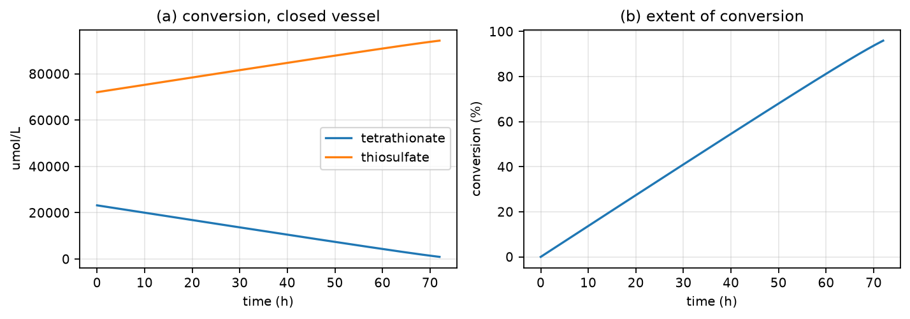
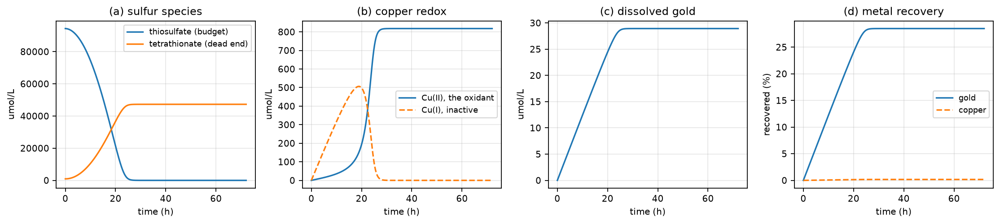
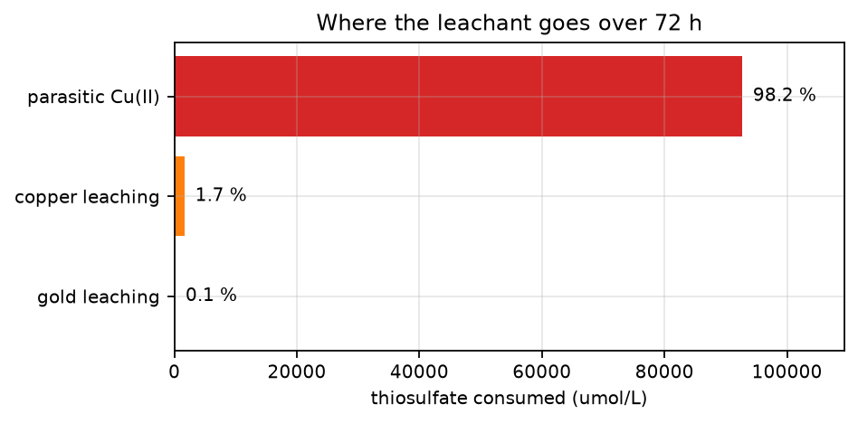
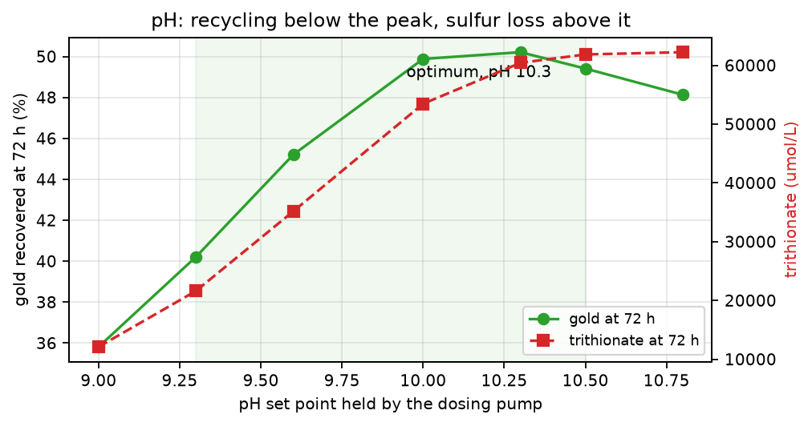
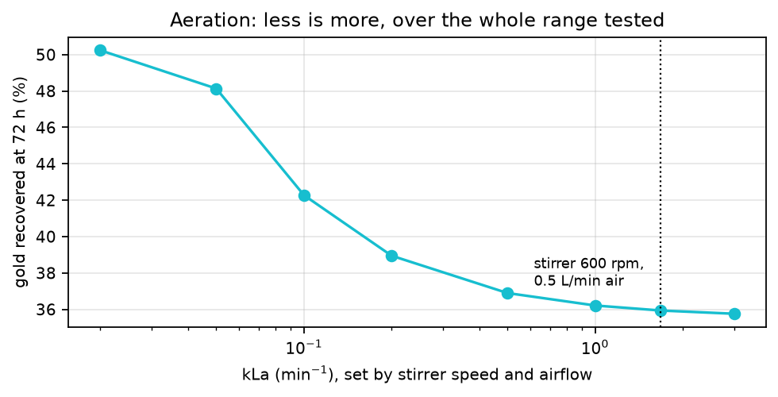
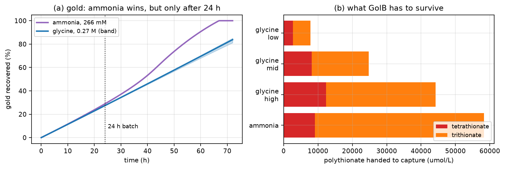
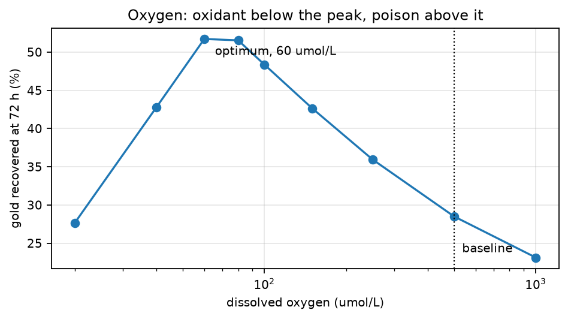
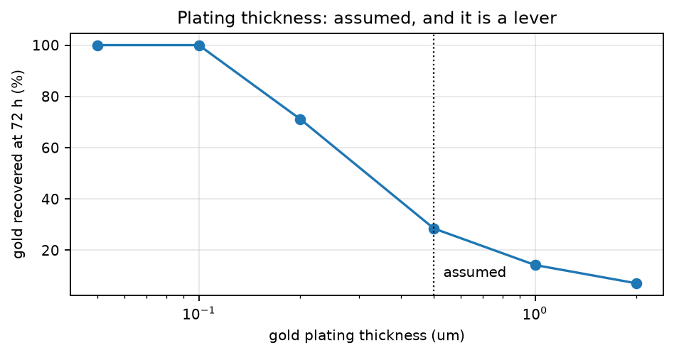
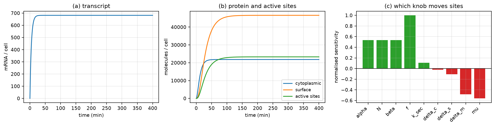
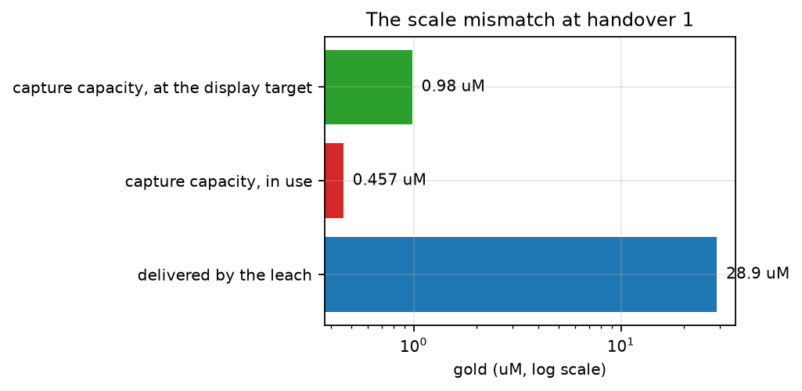

<!-- **Tier 4, generated.** Written by docs/build_review.py from REVIEW.md plus _review_parameters.md. Do not hand-edit: every run overwrites it. -->

<!-- **Tier 3, synthesis, and the deliverable.** Built to REVIEW.docx by
`python docs/build_review.py`, which also regenerates the figures and
Appendix A. `AGENTS.md` section 11. This declaration is a comment so that the
tier is still recorded in the repository, as section 11 requires, without
printing on page 1 of the reader's copy: pandoc drops raw HTML from .docx. -->

## Contents

- 1. The process
    - Conventions used throughout
- 2. Bioleaching — three vessels in series
    - 2.1 The culture vessel — making the enzyme
    - 2.2 The conversion vessel — making the leachant
    - 2.3 The leach vessel — dissolving the gold
    - 2.4 Four choices, and what each is worth
    - 2.5 What the leach model cannot yet answer
- 3. The finding we most want checked
- 4. The assumption with the largest leverage
- 5. GolB display — how many binding sites a cell carries
- 6. Recovery — reviewed separately
- 7. Where the chain does not fit together
- 8. Sensitivity and what to communicate
- 9. Every assumption we made, for your confirmation
- 10. The questions that block progress
- 11. Measurements to prioritise
- 12. How to review this
- Appendix A — every parameter in the model
    - A.1 Bioleaching — all three vessels
    - A.2 GolB surface display
    - A.3 Recovery chain
    - A.4 Constants used at the handovers
- Appendix B — references
    - B.1 Cited by the bioleaching model
    - B.2 Found while merging the three models
    - B.3 The model documents themselves


---

# 1. The process

Crushed printed circuit boards in, metallic gold out, without cyanide.

Waste boards are shredded to a powder holding a little gold, a great deal of
copper, and a mixture of other metals. Gold dissolves in **thiosulfate**
provided something is present to oxidise it. Rather than buy the thiosulfate we
make it: *Escherichia coli* is engineered to produce **tetrathionate hydrolase
(TetH)**, which converts tetrathionate into thiosulfate. A second population of
*E. coli* displays the gold-binding protein **GolB** on its surface, binds the
dissolved gold, and is filtered out. The gold is then stripped off the cells,
reduced back to metal, and collected.

**Three engineered constructs, not one.** TetH is expressed and harvested;
GolB stays on the cell and does its work there; a third construct supplies the
reductase for the final step.

How much protein each construct makes depends in part on how many copies of
its plasmid a cell carries. Two plasmids are involved:

| Construct | Plasmid | Copies per cell |
|---|---|---|
| GolB, displayed | pJUMP24-1A(sfGFP) | **300**, band 75–700 |
| TetH, harvested | pJUMP24-1A(sfGFP), the same one | **300**, band 75–700 |
| Reductase, cytoplasmic | pET-24(+) | about **50**, band 15–60 |

We have not counted copies in our own strains. Each figure is the published
range for the plasmid family: pJUMP24-1A carries a pUC-derived high-copy
origin, pET-24(+) a medium-copy pBR322 origin with *rop* present. The 50 is a
qPCR measurement of the nearest relative, 51 ± 8. Both are carried as a band
rather than as a single number (9, rows 20 and 20a).

GolB and TetH share a plasmid, so they share a copy number, and one expression
model covers both. The reductase does not: pET-24(+) carries about six times
fewer copies.

It does not follow that it makes six times less protein. pET-24(+) is a T7
vector, and a T7 promoter is several times stronger than the generic one GolB's
numbers assume. The two differences very nearly cancel, and the combined
expression figure lands within a factor of two of GolB's. Fewer copies, each
worked harder.

The model does not carry the reductase's copy number on its own. Promoter
strength, copy number and translation rate enter only as their product, so we
hold them as one number rather than three (6.3). The 50 above is a property of
the plasmid, not a model parameter.

```
  THE CULTURE VESSEL        E. coli culture
                            cells build the enzyme TetH, which is
                            harvested, refolded and purified
       |
  THE CONVERSION VESSEL     purified TetH + tetrathionate broth
                            TetH makes the leachant, thiosulfate, which
                            banks because no copper is present
       |
  THE LEACH VESSEL          thiosulfate liquor + crushed board
                            pH held by a dosing pump, air metered by a pump,
                            glycine as the copper ligand
                            thiosulfate dissolves the gold, and the copper,
                            and copper(II) destroys the thiosulfate
       |
  HANDOVER 1                dissolved gold becomes the capture feed
                            ALSO CROSSES: ~25 mM of polythionate, which
                            blocks the cysteines GolB binds gold with
       |
  THE CAPTURE VESSEL        gold binds to GolB on the cell surface
       |
  HANDOVER 2                sites per cell becomes capacity per gram
       |
  ELUTION                   thiourea strips the gold back off the cells,
                            into a SMALLER volume: the concentration step
       |                    ARM B, in parallel:
       |                      a third culture grows the reductase
       |                      and is lysed to supply it
       |
  THE REDUCTION VESSEL      eluate + lysate
                            the reductase makes metallic nanoparticles
       |
                            metallic gold, and one number: eta_total
       |
  (COLLECTION)              spin, wash, ash. NOT MODELLED: whatever
                            reaches metal is taken to be the product
```

## Conventions used throughout

**Units.** Concentrations are µmol L⁻¹, which is the same unit as µM. Solid
metal is counted in µmol because it is not dissolved. Leaching and expression
run in minutes; the recovery chain runs in hours. Only quantities carrying a
time dimension convert between the two.

**Symbols.** An upper-case letter is a quantity per litre of liquid, a
lower-case letter is a quantity per cell or per particle. `k` is always a rate
constant, `K` always a half-saturation concentration, `μ` the cell growth rate.

**One shape appears everywhere:**

$$\theta(x,K)=\frac{x}{K+x}$$

A saturation factor running from 0 to 1. It answers "how busy is this
reaction?". At $x = K$ the answer is one half, so `K` is the concentration at
which a step runs at half its top speed.

---

```{=openxml}
<w:p><w:r><w:br w:type="page"/></w:r></w:p>
```
# 2. Bioleaching — three vessels in series

Source: *Bioleaching Modelling [Sequential] — Process Overview*, with its MATLAB
implementation. Both are in `docs/source/sequential_2026-08-12/`.

| Vessel | Contents | What it makes |
|---|---|---|
| **The culture vessel** | *E. coli* culture | the enzyme: TetH, harvested and purified |
| **The conversion vessel** | purified TetH + tetrathionate broth | the leachant: thiosulfate liquor |
| **The leach vessel** | thiosulfate liquor + crushed PCB | dissolved gold, and unavoidably copper |

**Why three vessels and not one.** The enzyme, the leachant and the metal each
poison one of the others when they share a tank. Separating them is also the
only way to refold TetH outside the cell, which the literature says is
necessary. A one-pot design was written first and retired on 12 August 2026.

## 2.1 The culture vessel — making the enzyme

The cells build TetH continuously and lose it two ways: proteases break it down,
and every division shares it between two cells.

$$\frac{d[E]}{dt}=k_{syn}X-(k_{deg}+\mu)[E]$$

Steady state arrives in about 55 minutes, far faster than anything downstream,
so only the steady state is used:

$$[E]_{culture}=\frac{k_{syn}X}{k_{deg}+\mu}=4.75\times10^{-3}\ \mu\text{mol L}^{-1}$$

That is about 2,860 molecules per cell, roughly 0.3 % of total cell protein — a
modest burden. **This vessel sizes the culture and then leaves the model.** It
does not appear in the conversion or leach equations.

### How much culture that takes

The conversion vessel needs the enzyme at 0.043 µmol L⁻¹, but a culture only
ever reaches 0.00475 µmol L⁻¹ — above that, degradation and division cancel out
any further gain. **So the enzyme must be concentrated: many litres of culture
are harvested into one litre of the conversion vessel.**

Harvesting neither creates nor destroys enzyme, so the amount taken out equals
the amount put in:

$$[E]_{culture}\times V_{culture}=E_2\times V_{conversion}
\qquad\Longrightarrow\qquad
\frac{V_{culture}}{V_{conversion}}=\frac{E_2}{[E]_{culture}}$$

The ratio of volumes is the ratio of concentrations, upside down. Written as a
ratio because it scales: ten litres of conversion vessel needs ten times as
much culture.

| Symbol | Meaning | Unit | Value |
|---|---|---|---|
| `k_syn` | enzyme built per cell | µmol cell⁻¹ min⁻¹ | 8.74×10⁻¹⁷ |
| `X` | biomass | cell L⁻¹ | 1×10¹² |
| `k_deg` | enzyme degradation | min⁻¹ | 1.1×10⁻³ |
| `μ` | growth dilution, 40 min doubling | min⁻¹ | 0.0173 |

**Every value in that table is the source document's, and the repository runs
none of them.** `k_syn` and `X` are held at `null`, so anything asking for them
raises a `KeyError` and Appendix A shows them as null. `μ` differs too: the
table's 0.0173 is a 40-minute doubling, and `params/leach.yaml` holds 0.02 for
a 35-minute one. The 4.75×10⁻³ µmol L⁻¹ is the source document's own result,
reproduced here, not a repository output.

⚠ **One caution on how the code behaves.** `src/leach.py :: simulate` reads
`k_syn` with `.get`, so a run with it null does not fail — it returns an empty
`stage1` and carries on. The culture vessel disappears from the result without
saying so.

**Result, on the source document's constants.** Charging the conversion vessel
to 0.043 µmol L⁻¹ takes **9.1 litres of culture per litre of conversion
vessel**, which is 2.15 mg of purified TetH. The protein mass is trivial; the
culture volume is the real cost.

### The repository's own route disagrees, by 77×

⚠ **The `k_syn × X` route above is retired, and this section is the only place
still using it.** `params/leach.yaml` says so in the comment
above `enzyme_capacity`: that block is this repository's replacement for the
`k_syn × k_cat` pair, because no measurement can separate the two. What the
leach model actually runs on is Part II's expression cascade:

$$23{,}301\ 	frac{	ext{molecules}}{	ext{cell}}	imes4.0\ 	frac{	ext{g}}{	ext{L}}
	imes2.36	imes10^{12}\ 	frac{	ext{cells}}{	ext{g}}\div6.022	imes10^{23}
=0.3653\ \mu	ext{mol L}^{-1}$$

| Route | TetH in the culture | Culture per litre of conversion vessel |
|---|---|---|
| The source document, via `k_syn` | 0.00475 µmol L⁻¹ | **9.1 L** |
| **The repository, via `enzyme_capacity`** | **0.3653 µmol L⁻¹** | **0.12 L** |

**The two answers differ by 77×, and they differ in direction.** On the
repository's route the culture already sits **8.5× above** the 0.043 the
conversion vessel needs, so the harvest would be diluted rather than
concentrated, and the concentration step this section is built around does not
exist. The same 0.3653 µmol L⁻¹ reproduces the `Vmax` of 80.36 µmol L⁻¹ min⁻¹
the parameter file records, so it is the number the leach runs on.

**Which is right is not settled, and the gap is not a sourcing problem.** TetH
borrows GolB's 23,301 molecules per cell as a labelled proxy, and that proxy is
77× more generous than the enzymology estimate the source document built from
*Acidithiobacillus* specific activities. One of the two is wrong about TetH by
almost two orders of magnitude. `ISSUES.md` item 68; pinned by
`tests/test_leach.py :: test_two_enzyme_routes_disagree_77x`.

⚠ **Read the 9.1 L as the conservative end, not as the answer.** Nothing
downstream depends on it — the culture vessel sizes itself and then leaves the
model — so the disagreement changes no other number in this document.

**Note which loss dominates.** Division removes enzyme sixteen times faster than
proteolysis. A protease-resistant enzyme buys almost nothing. Growing slower, or
expressing more, buys a great deal.

## 2.2 The conversion vessel — making the leachant

$$S_4O_6^{2-}+H_2O\;\rightarrow\;S_2O_3^{2-}+S^0+SO_4^{2-}+2H^+$$

**Where the starting concentrations come from.** The 46 g L⁻¹ broth contains
30 g L⁻¹ sodium thiosulfate pentahydrate and **no tetrathionate**. Tetrathionate
is generated in situ when the iodine solution is added at the point of use:

$$I_2+2S_2O_3^{2-}\;\rightarrow\;2I^-+S_4O_6^{2-}$$

Iodine is limiting, so only part converts: 23.2 mM tetrathionate and 72.1 mM
thiosulfate. Both are inherited from the medium, not model outputs.

There are no cells here, so the enzyme concentration is a constant we choose.
There is no copper, so nothing destroys the product. Every loss term vanishes:

$$\frac{d[S_4O_6^{2-}]}{dt}=-\frac{k_{cat}E_2[S_4O_6^{2-}]}{K_{S4O6}+[S_4O_6^{2-}]}
\qquad
\frac{d[S_2O_3^{2-}]}{dt}=+Y\,\frac{k_{cat}E_2[S_4O_6^{2-}]}{K_{S4O6}+[S_4O_6^{2-}]}$$

| Symbol | Meaning | Unit | Value |
|---|---|---|---|
| `E_2` | purified TetH charged in | µmol L⁻¹ | 0.043, a design variable |
| `k_cat` | turnover per enzyme molecule | min⁻¹ | 125 |
| `K_S4O6` | half-saturation on tetrathionate | µmol L⁻¹ | 300 |
| `Y` | thiosulfate per tetrathionate | — | 1 |
| `t_2` | duration | min | 4,320 (three days) |

Because `Y` = 1 no sulfur leaves the tank, which gives a free correctness check,
and the tank has an exact solution to check the solver against:

$$[S_4O_6^{2-}]+[S_2O_3^{2-}]=\text{constant}
\qquad
K_{S4O6}\ln\frac{S_0}{S}+(S_0-S)=k_{cat}E_2\,t$$



**Result: 95.9 % conversion in three days.** Tetrathionate falls 23,200 → 941
µmol L⁻¹, thiosulfate rises 72,100 → 94,359 µmol L⁻¹. The reaction is
effectively zero-order for almost the whole run — with substrate at 23,200
against `K_S4O6` = 300 the saturation factor starts at 0.987 — which is why the
curve is a straight line rather than a decaying exponential.

**This is the single largest benefit of the three-vessel design.** The final
94.4 mM is close to the 0.1 M the gold-leaching literature calls optimal. In one
pot, thiosulfate never accumulated past a few millimolar.

## 2.3 The leach vessel — dissolving the gold

The conversion vessel's product is charged in with crushed PCB powder. **There is no enzyme
and no tetrathionate feed**, so thiosulfate has no source and can only be spent.

### Gold

$$Au^0+2S_2O_3^{2-}\;\rightarrow\;Au(S_2O_3)_2^{3-}+e^-$$
$$4Au^0+8S_2O_3^{2-}+O_2+2H_2O\;\rightarrow\;4Au(S_2O_3)_2^{3-}+4OH^-$$
$$Au^0+2S_2O_3^{2-}+Cu(II)\;\rightarrow\;Au(S_2O_3)_2^{3-}+Cu(I)$$

Gold on a board is a thin plated film, so it dissolves by thinning at constant
face area, independent of crush size:

$$a_{Au}=\frac{m_{Au}}{\rho_{Au}\,t_{film}}=2.07\times10^{-3}\ \text{m}^2$$

$$R_{Au}=a_{Au}(t)\,\theta(S_2O_3,K_{S2O3})
\left[k_{Au,O2}\,\theta(O_2,K_{O2})+k_{Au,Cu}\,\theta(Cu(II),K_{CuII})\right]$$

$$\frac{dn_{Au}}{dt}=-R_{Au}\qquad\frac{d[Au(S_2O_3)_2^{3-}]}{dt}=+\frac{R_{Au}}{V}$$

**The two oxidant terms add; everything else multiplies.** Either oxidant alone
can do the job. But nothing happens without exposed area and without
thiosulfate, so those multiply through both. Oxygen enters only its own term,
because Cu(II) does not need oxygen at the gold surface.

### Copper

$$4Cu^0+O_2+8S_2O_3^{2-}+2H_2O\;\rightarrow\;4[Cu(S_2O_3)_2]^{3-}+4OH^-$$
$$Cu^0+Cu^{2+}+4S_2O_3^{2-}\;\rightarrow\;2[Cu(S_2O_3)_2]^{3-}$$
$$4Cu(I)+O_2+2H_2O\;\rightarrow\;4Cu(II)+4OH^-$$
$$2Cu(II)+2S_2O_3^{2-}\;\rightarrow\;2Cu(I)+S_4O_6^{2-}$$

Copper is bulk metal, so its particles erode inward:

$$a_{Cu}(0)=\frac{6\,m_{Cu}}{\rho_{Cu}\,d}\qquad
a_{Cu}(t)=a_{Cu}(0)\left(\frac{n_{Cu}}{n_{Cu}(0)}\right)^{2/3}$$

$$v_{Cu,O2}=k_{Cu,O2}\,a_{Cu}(t)\,\theta(O_2,K_{O2})\,\theta(S_2O_3,K_{S2O3})$$
$$v_{Cu,Cu}=k_{Cu,Cu}\,a_{Cu}(t)\,\theta(Cu(II),K_{CuII})\,\theta(S_2O_3,K_{S2O3})$$
$$v_{3}=k_{par}[Cu(II)][S_2O_3^{2-}]\qquad v_{4}=k_{ox,Cu}[O_2][Cu(I)]$$

### The balances

$$\frac{dn_{Cu}}{dt}=-(v_{Cu,O2}+v_{Cu,Cu})$$

$$\frac{d[S_4O_6^{2-}]}{dt}=+v_3-v_{alk}\qquad
\frac{d[S_3O_6^{2-}]}{dt}=+\tfrac{1}{2}v_{alk}$$

$$\frac{d[S_2O_3^{2-}]}{dt}=-\frac{2R_{Au}}{V}
-\frac{2v_{Cu,O2}+4v_{Cu,Cu}}{V}-2v_3+\tfrac{5}{4}v_{alk}$$

$$\frac{d[Cu(I)]}{dt}=\frac{v_{Cu,O2}+2v_{Cu,Cu}+R_{Au,Cu}}{V}+2v_3-4v_4$$
$$\frac{d[Cu(II)]}{dt}=4v_4-\frac{v_{Cu,Cu}+R_{Au,Cu}}{V}-2v_3$$

$$\frac{d\,Alk}{dt}=4v_4+\frac{R_{Au,O2}}{V}+\frac{v_{Cu,O2}}{V}
-2v_{hyd}-\tfrac{3}{2}v_{alk}$$

$$\frac{d[O_2]}{dt}=k_La\,(C^{*}-[O_2])
-\frac{R_{Au,O2}+v_{Cu,O2}}{4V}-v_4$$

Every coefficient is a molecule count read off a balanced reaction. **The
oxygen routes consume no copper(II) at all.**

**Three of these terms are switches, and all three are off in the base model.**
They are what the operating case turns on, and section 2.4 is about them.

| Term | What it adds | Off by default because |
|---|---|---|
| $v_{alk}$ | tetrathionate decomposes in alkali | needs a pH set point, and none is chosen |
| $[O_2]$ balance | the air pump instead of an imposed constant | needs the vessel's own $k_La$ |
| pH control | pH becomes an input; the model reports titrant demand | needs a pH set point |

**pH is tracked as alkalinity, not as free protons,** when no pump is present:
a run produces about 100,000 µmol L⁻¹ of net base against a free proton pool of
0.1 µmol L⁻¹, so tracking free protons drives the pH negative by construction.
With the pump on, alkalinity stops moving and the model reports instead how
much acid or base the pump must deliver.

| Symbol | Meaning | Unit | Value |
|---|---|---|---|
| `k_Au,O2` / `k_Au,Cu` | gold rate constants, two routes | µmol m⁻² min⁻¹ | 11.4 / **21.0** |
| `k_Cu,O2` / `k_Cu,Cu` | copper rate constants | µmol m⁻² min⁻¹ | 200 / 200 |
| `K_O2` | oxygen half-saturation | µmol L⁻¹ | 50 |
| `K_S2O3` | thiosulfate half-saturation | µmol L⁻¹ | 3,376 |
| `K_CuII` | Cu(II) half-saturation | µmol L⁻¹ | 5×10⁴ |
| `k_par` | parasitic rate constant | L µmol⁻¹ min⁻¹ | 1.20×10⁻⁵ |
| `k_ox,Cu` | Cu(I) re-oxidation constant | L µmol⁻¹ min⁻¹ | 1×10⁻⁴ |
| `k_alk` | alkaline decomposition of tetrathionate | L mol⁻¹ min⁻¹ | 16.8 **secondary source** |
| `t_film` | gold plating thickness | m | 0.5×10⁻⁶ **assumed** |
| `d` | crushed particle size | m | 6×10⁻³ |
| `[O2]` | dissolved oxygen, imposed in the base model | µmol L⁻¹ | 500 |
| `C*` / `kLa` | air saturation / mass transfer, operating case | µmol L⁻¹, min⁻¹ | 259 / 1.68 |
| `n_Au(0)` / `n_Cu(0)` | metal on the boards, 100 g L⁻¹ PCB | µmol | 101.5 / 472,069 |

**`k_Au,Cu` is the ammonia-free value.** The often-quoted 1,500 is measured in
ammoniacal solution, where ammonia holds Cu(II) as the cupric-tetraammine
complex — a far stronger oxidant. This process uses glycine, not ammonia, so
1,500 does not describe it. `k_par` moves with it for the same reason.

### The base model: what the chemistry does unaided



Thiosulfate is abundant for the first day and gold leaches close to its
maximum, reaching **27.8 % at 24 hours**. Then it runs out. Cu(II) peaks at
818 µmol L⁻¹ and keeps rising after leaching has already stopped, which is the
clearest sign that copper is not paying for the leachant it destroys. **Gold
reaches 28.5 % at 72 hours; copper 0.17 %.** Almost nothing is gained after
day one.



**The leachant is not consumed by leaching. It is consumed by copper(II).**
Everything in the next section is an attempt to change that one number.

---

## 2.4 Four choices, and what each is worth

The base model has no process control in it. The team has a pH sensor with a
dosing pump and a variable air pump, and has to pick a ligand and a batch time.
Each choice is below with its reason, its size, and the decision taken.

### Choice 1 — pH set point. **Decision: hold 10.0 to 10.3.**

Gold dissolution is reported flat over pH 9 to 11, so **pH is not chosen for
gold**. It is chosen for whether the leachant survives. Raising pH opens the
alkaline decomposition of tetrathionate, which hands most of the wasted sulfur
back:

$$4S_4O_6^{2-}+6OH^-\;\rightarrow\;5S_2O_3^{2-}+2S_3O_6^{2-}+3H_2O$$

Tetrathionate stops being a dead end, and gold at 72 h rises from 28.5 % to
50.2 %. That is the largest single term in the model.

**But the return leg is not free.** Five of every eight sulfur atoms come back
as thiosulfate; the other three leave as trithionate, which nothing consumes at
25 °C. Push the pH higher and the process recycles faster *and* loses sulfur faster.
The
two effects cross, and the result is an interior optimum.



⚠ **That optimum is a property of the base model's imposed oxygen, and it does
not survive the operating case.** The figure holds `[O2]` at 500 µmol L⁻¹. Model
the air pump instead, which is choice 2 below, and the peak disappears: gold
runs 41.5 → 45.3 → 50.2 → 56.2 → 58.6 → 59.2 → 59.3 % across pH 9.0 to 10.8,
**monotonically**. Add glycine as well, which is choice 3, and pH is worth less
than a point on gold across the entire range.

**So pH is not chosen for gold either.** In the full operating case it is
chosen for the polythionate load it hands the capture step — which is the
blocking item 44 — and there it matters a great deal:

| pH | gold at 72 h | polythionate to capture |
|---|---|---|
| 9.3 | 83.4 % | 29,204 µM |
| 10.0 | 83.8 % | 24,798 µM |
| 10.5 | 83.9 % | 23,205 µM |
| 11.0 | 84.0 % | **22,631 µM** |

**Higher is better on both counts, and the ceiling is external to the model.**
The chelating form of glycine is 77 % dissociated at pH 10.3 against 84 % at
10.5, so the gain flattens, and copper hydroxide precipitates above about 10.5
and would passivate the particles — **that precipitation is literature, not
model output.** The floor is pH 9.3, below which thiosulfate decomposes and
there is too little chelating glycine. The direction holds across the whole
`eps_gly` band; only its size changes.

### Choice 2 — aeration. **Decision: run the air pump at its lowest workable setting.**

Oxygen does two opposite things. It drives the gold and copper reactions, and
it re-oxidises Cu(I) to the Cu(II) that destroys the leachant. The second
effect dominates.

The base model imposes 500 µmol L⁻¹, which is **above what air can dissolve at
all** — saturation is 259 µmol L⁻¹, and only pure-oxygen sparging reaches 500.
Simply modelling the pump instead of imposing a constant lifts gold from
28.5 % to 35.9 %. Turning the pump down lifts it further, monotonically over
the whole range tested.



This is the cheapest change available: it costs nothing and saves power.

### Choice 3 — the ligand. **Decision: glycine, and it loses the gold column.**

Copper(II) destroys 98 % of the leachant. The fix is a ligand that holds Cu(II)
still while still letting it oxidise gold. Ammonia does this and is the
literature standard. Glycine does the same job through copper glycinate.

Both scenarios below run at the same pH, aeration, crush and batch time, so
every difference is the ligand.



| | gold 24 h | gold 72 h | polythionate to capture | titrant |
|---|---|---|---|---|
| ammonia, 266 mM | 28.9 % | **100.0 %** | 58,336 µM | −68,758 µM |
| glycine, 0.27 M | 27.2–27.5 % | 81–85 % | 7,817–44,187 µM | −13,415 to −58,960 µM |

**Ammonia wins on gold and we are not choosing it.** Four reasons:

1. **At 24 hours the two are the same**, within 1.7 points. Ammonia's advantage
   lives entirely in the second and third day.
2. **Ammonia is volatile and the air pump would strip it.** Above pH 9.25 it is
   mostly free NH₃, and sparging air through alkaline ammoniacal liquor is the
   standard method for driving ammonia out of water. The ammonia column assumes
   this does not happen, so it is an upper bound the vessel cannot reach.
   Glycine is non-volatile, so pH and airflow stay independent knobs.
3. **Glycine hands the capture step 2.4× to 7.5× less polythionate.** Section 7
   is blocked on exactly that number. Reaching 100 % gold is worth nothing if
   the capture protein cannot survive the liquor it arrives in.
4. **Ammonia cannot be deployed at Agbogbloshie.** It is toxic and needs fume
   control. Glycine is food grade and biodegradable.

The comparison is deliberately generous to ammonia: no stripping, its own
measured constants against glycine's unmeasured one, and a Cu(I) re-oxidation
constant that is ammoniacal in both columns because no ammonia-free value
exists. Glycine loses the gold column under all three handicaps and still wins
the decision.

### Choice 4 — batch time. **Decision: run one day, not three.**

In the base model the extra 48 hours are worth **0.7 percentage points**,
because the leachant is gone by hour 27. In the operating case they are worth
more, but they also more than double the polythionate the capture step must
survive. **Choice 4 is not a leach decision.** It is set by what section 7 can
absorb, and section 7 is not settled.

### Crush size, for completeness

Finer crushing exposes more copper, which makes more Cu(II), which destroys
more leachant. Gold sits in a plated film whose area does not depend on crush
size at all, so finer crushing buys gold nothing. At 2 mm gold falls to 16.4 %
against 28.5 % at 6 mm. **Coarser is better**, which is the opposite of the
usual rule, and it holds only because the model has no liberation term — below
some size gold on unbroken board is simply not reachable, and the model cannot
see that limit.

---

## 2.5 What the leach model cannot yet answer

Two constants carry the operating case, and neither is secure.

| Constant | Controls | State |
|---|---|---|
| `k_alk` | the whole pH lever, 28.5 % → 50.2 % | **secondary sources only**; the primary papers are paywalled and unread |
| `eps_gly` | the size of the glycine benefit | **unmeasured**; calibrated indirectly, and the calibration spans 17× |

`eps_gly` spans 17× but gold spans under 4 points across that whole band, so
the *recommendation* is safe and the *number* is not. `k_alk` has no such
comfort: nothing in this repository has checked it against a primary source,
and it is the largest term in the model. **No figure that depends on it should
enter a report until Rolia & Chakrabarti 1982 or Zhang & Dreisinger 2002 is
read.**

Five things have no term at all: sulfur fouling of the gold surface, gold
liberation at fine crush sizes, copper hydroxide precipitation, the other
metals on a board, and temperature. The first is the largest missing physics;
the third is why the pH ceiling in Choice 1 is argued from literature rather
than computed.

---

```{=openxml}
<w:p><w:r><w:br w:type="page"/></w:r></w:p>
```
# 3. The finding we most want checked

Copper metal does **not** dissolve as Cu(II). It dissolves as Cu(I), on both
routes. There is exactly one reaction anywhere in the model that produces
Cu(II), and it is the oxygen one:

$$4Cu(I)+O_2+2H_2O\;\rightarrow\;4Cu(II)+4OH^-$$

So the substance that destroys 98.2 % of the leachant is not supplied by the
board. **It is supplied by the sparger**, and dissolved oxygen is an operating
choice. Oxygen drives the leaching routes *and* manufactures the poison, so gold
recovery has an interior maximum in `[O₂]` rather than rising with aeration.



**Turning the sparger down is worth 23 percentage points and costs nothing.**
It is the cheapest change available anywhere in the process.

**What is solid and what is not.** The *existence* of the optimum survives every
value of `k_par` we tested, though its position moves. The number 80 does not:
it rests on `k_par` and `k_ox,Cu`, both borrowed from ammoniacal literature
where ammonia deliberately stabilises Cu(II).

**The one objection to this finding has since been removed.** The table above
holds `[O₂]` rather than solving it, and running deliberately oxygen-poor is
exactly the regime where a held `[O₂]` is least defensible. The model now
carries an oxygen balance driven by the air pump, and it reaches the same
conclusion from the other direction — see section 2.4, Choice 2. That is why
this finding is now a recommendation rather than a hypothesis. **The set point
is still not 80.** Set the airflow, measure the dissolved oxygen, and let the
vessel settle the set point.

---

```{=openxml}
<w:p><w:r><w:br w:type="page"/></w:r></w:p>
```
# 4. The assumption with the largest leverage

Gold area goes as one over the plating thickness, so the thickness scales the
whole leaching rate. Mixed e-waste carries no supplier specification, so we
assumed 0.5 µm.



Across the range the boards plausibly carry, gold at 72 h runs from
**100 % at 0.05 µm to 7.1 % at 2.0 µm**, against 28.5 % at the assumed 0.5 µm.
A thinner film is a larger area for the same mass of gold, so it leaches
faster.

**We do not control this number; the boards do.** If anyone can measure plating
thickness on a representative sample, it removes the largest single uncertainty
in the leaching model.

---

```{=openxml}
<w:p><w:r><w:br w:type="page"/></w:r></w:p>
```
# 5. GolB display — how many binding sites a cell carries

Source: the GolB surface-display document, `docs/02_golb_expression.md`.

A queue of three pools, each fed from upstream and drained by decay and by
growth dilution:

$$\frac{dm}{dt}=\alpha N-(\delta_m+\mu)m$$
$$\frac{dP_c}{dt}=\beta m-(k_{sec}+\delta_c+\mu)P_c$$
$$\frac{dP_s}{dt}=k_{sec}P_c\left(1-\frac{P_s}{P_{s,max}}\right)-(\delta_s+\mu)P_s$$
$$s=f\,P_s$$

`m` is mRNA per cell, `P_c` protein inside the cell, `P_s` protein on the
surface, `s` the working sites. The bracket is crowding: the surface has a
finite number of anchor points, so export slows as it fills.

| Symbol | Meaning | Value |
|---|---|---|
| `α` | promoter strength | 0.5 mRNA min⁻¹ copy⁻¹ |
| `N` | plasmid copy number | 300, band 75–700 |
| `β` | translation rate | 4.0 |
| `k_sec` | export rate | 0.10 min⁻¹ |
| `δ_m`, `δ_c`, `δ_s` | decay of each pool | 0.20, 0.005, 0.005 min⁻¹ |
| `μ` | growth rate | 0.02 min⁻¹ |
| `f` | correctly folded fraction | 0.5, **fitted** |
| `P_s,max` | anchor points on the surface | 1×10⁵ per cell |

At steady state the cascade collapses to one expression, which is what says
which knobs are worth turning:

$$s^{*}=\frac{f\,\alpha N\beta k_{sec}}
{(\delta_m+\mu)(k_{sec}+\delta_c+\mu)(\delta_s+\mu)}$$



**Reading panel (c).** Folding fraction scores +1.00; promoter strength, copy
number and translation rate score +0.53 each, and anchor capacity +0.47. `k_sec`
scores only **+0.11** because it appears top and bottom — raising it mostly
moves protein from inside the cell to the surface without making more of it.
Above about 1 min⁻¹ the site count flattens near 26,000 and export stops
limiting anything at all; our 0.10 min⁻¹ sits on the upper shoulder.
**`μ` scores −0.56 and is the strongest negative term.** ⚠ **Do not read that
as process guidance.** Site density is weakly hyperbolic in `μ`; biomass is
exponential in it. Slowing growth four-fold raises per-cell density 1.6× and
cuts capture **per litre** about a thousand-fold. Growth wins, always.

The resolution is to separate the stages in time: grow and express in rich
medium, then harvest and resuspend the cells in the leachate, where `μ` ≈ 0 and
the site count is whatever was built beforehand. The steady state below is a
**pre-load target reached in a separate vessel**, not a condition held in the
leach liquor — where it could not be held anyway.

**Result: 23,301 working sites per cell**, using **46.6 %** of the 100,000
available anchors.

⚠ **The limiting resource has moved from the gene to the membrane.** The wet lab
confirmed a pUC-type high-copy backbone, so `N` = 300 rather than the source
document's 20. At that copy
number the surface is half full, the promoter, copy number and RBS drop from
+1.00 to +0.53, and the anchor capacity arrives at +0.47 having been irrelevant
before. **Only the folding fraction keeps its full +1.00**, because it
multiplies the surface pool after all the saturation has happened. The
productive handles are now `f` and the display scaffold. `ISSUES.md` item 61.

---

```{=openxml}
<w:p><w:r><w:br w:type="page"/></w:r></w:p>
```
# 6. Recovery — reviewed separately

The audited recovery model, complete equations, numerical results and figures
are in [RECOVERY.md](RECOVERY.md), built as [RECOVERY.docx](RECOVERY.docx).
The recovery-only wiki proposal is [WIKI_RECOVERY.md](WIKI_RECOVERY.md).

The model links capture, elution and metal formation. Its nominal result is
conditional on proxy kinetics and equal-volume transfers. The full declared
kinetic ranges include poor reduction, so complete conversion is not an
established result. The review fixes calibration, dilution, numerical and
sensitivity defects and distinguishes verification from validation.

The protein-production model now dilutes intracellular molecules at actual
specific growth. The previous harvest and deficit recommendations no longer
follow. The capture damage coefficient remains null because its source formula
has incompatible units. See [ISSUES.md](ISSUES.md), items 84–89.

---

```{=openxml}
<w:p><w:r><w:br w:type="page"/></w:r></w:p>
```
# 7. Where the chain does not fit together



Capture turns over at $q_{max}X_{max}$. At the site density we can currently
build, and 5 g L⁻¹ of cells, that ceiling is **0.46 µM**. The leach delivers
**29 µM**.

In use is 23,301 sites per cell and `q_max` = 0.0913. Filling every one of the
100,000 anchors would give 0.1961 and a 0.98 µM ceiling. The retired value of
4.4 would have given 22 µM and was abandoned because it needed 742,225 anchor
points on a cell that has about 100,000.

**The two halves of the process are sized about 63× apart.**

**Note what is left to give.** In use is already 46.6 % of the anchors, so
filling every remaining one buys 2.1× more — the gap closes to 30× and no
further. **Copy number cannot fix this; only the scaffold and the
folding fraction can, and together they cannot close 30×.** The volume
reduction below is not optional. There is currently no feed concentration at which capture is not
capacity-limited, and no stopping rule on the leach fixes it — improving the
leach makes the mismatch worse, because recovered gold and feed concentration
are the same number.

**Two further things cross this handover that the capture model does not
represent at all:** about 820 µM of copper, and tens of thousands of µM of
polythionate. Polythionates are thiol-blocking reagents and GolB binds gold
through a Cys-X-X-Cys motif.

| | tetrathionate | trithionate | ratio to GolB cysteines |
|---|---|---|---|
| base model | 47,272 µM | 0 | 51,800 : 1 |
| operating case, glycine | 8,220 µM | 16,578 µM | 9,000 : 1 measured, **27,200 : 1 bound** |
| ammonia, for comparison | 9,097 µM | 49,239 µM | 9,900 : 1 measured, **63,900 : 1 bound** |

The cysteine pool these ratios are measured against is `q_max`. **Nothing about
item 44 changes at this scale.** A blocking
reagent present at fifty thousand times the target does not become tolerable at
nine thousand.

**The second ratio is a bound, not a result.** Tetrathionate's mechanism is
established: the cysteine thiolate attacks its outer sulfur to give a
cysteine-S-sulfonate, and across a Cys-X-X-Cys motif the intermediate closes an
intramolecular disulfide. **Trithionate's reactivity relative to tetrathionate
is not published**, so it is counted here as if equal, which is the worst case.
One binding assay in each would turn the bound into a result.

The blocking is reversible with thiol reductants, so it is actionable, but
nothing in the capture model currently accounts for it.

---

```{=openxml}
<w:p><w:r><w:br w:type="page"/></w:r></w:p>
```
# 8. Sensitivity and what to communicate

Recovery sensitivity is conditional on both the operating point and the
selected parameter ranges. The revised recovery figure covers the complete
nucleation and growth ranges in YAML. It exposes a large reduction uncertainty
that the older narrow tornado concealed. See [RECOVERY.md](RECOVERY.md).

The broad tornado generator now reads those same full kinetic ranges. Its
one-at-a-time bars are comparisons of chosen scenarios, not universal rankings.
Low upstream influence on captured amount does not establish matrix compatibility:
the model does not couple all leachate species to binding and reduction.

Historical PRCC results are not current evidence. Their original sampling
ranges are untracked and their stage assumptions have changed. The repaired
ensemble runner enables future specified studies, but its smoke test is not a
new published uncertainty distribution. A new PRCC analysis needs a defensible
sampling model and monotonicity checks.

The separate leach Monte Carlo figures describe variation in selected leach
inputs only. They are not confidence intervals on the full recovery process.
Prioritise the recovery stage balance, capture regimes, elution candidates and
full reduction scenario map for the recovery wiki.

---

```{=openxml}
<w:p><w:r><w:br w:type="page"/></w:r></w:p>
```
# 9. Every assumption we made, for your confirmation

Please mark each one **agree**, **disagree**, or **do not know**, and add a note.
Every parameter in Appendix A whose status is *assumed*, *fitted*, *unmeasured*
or *placeholder* appears somewhere in this table.

| # | Assumption | Why we made it | Your answer |
|---|---|---|---|
| 1 | Gold plating thickness is 0.5 µm | Mixed e-waste has no supplier specification. Scales the whole leach rate. | |
| 2 | Crushed particle size is 6 mm | Taken from the source document. We control this one. | |
| 3 | The base model holds dissolved oxygen at 500 µmol L⁻¹ and never depletes | Above air saturation, 259 µmol L⁻¹. A mass-transfer term now exists (`kLa` = 1.68 min⁻¹) and the operating case of 2.4 uses it; the base model keeps the imposed value so the conservative floor does not move. | |
| 4 | `k_par` and `k_ox,Cu` from ammoniacal literature apply to our ammonia-free system | No ammonia-free values published. Ammonia stabilises Cu(II), so ours may be worse. | |
| 5 | `k_cat` = 125 min⁻¹, measured at pH 3, applies at our operating pH | It is the only published value. Thiosulfate decomposes in acid, so the two requirements conflict. | |
| 6 | TetH refolds to full activity after harvesting | The published procedure refolds at pH 4 in a tube. No yield term exists for this step. | |
| 7 | Purification recovers 100 % of the enzyme | Nothing accounts for losses, so 9.1 L of culture per litre is a floor. This is v5's own figure; v5 also states 5.5 L in section 2, a 1.65× self-contradiction we did not resolve (`ISSUES.md` item 58). | |
| 8 | Folding fraction `f` = 0.5 for TetH | It is the fitted value for GolB. TetH is a different protein and it scales the enzyme pool linearly. | |
| 9 | The reactor is perfectly mixed and isothermal, with uniform spherical particles and a uniform gold film | Standard idealisation. Temperature was deliberately deferred on 11 August. | |
| 10 | Dissolved gold never re-precipitates | Free thiosulfate reaches zero while 30 g of metallic copper remains, and gold is known to plate onto copper under those conditions. | |
| 11 | No passivation film forms on the gold surface | The source text says passivation multiplies these rates; no such term appears in the equations. | |
| 12 | All reduced gold is recovered; physical collection is out of scope | Spinning, washing and ashing are not free, so every `η_total` here is an upper bound. Nanoparticles also do not settle under gravity, so collection is a unit operation and not a waiting period. | |
| 13 | The enzyme stays fully active for the whole three-day conversion | No decay term exists in the conversion vessel. `params/leach.yaml` records the half-life as missing. | |
| 14 | Buffer capacity `β` = 1×10⁵ | Needs calibration against the real broth. It scales the whole pH trace. | |
| 15 | `K_Au` = 0.7 µM, not the 10 µM in the display document | The 0.7 µM value is fitted from a GolB-based saturation curve (S78). It is still a proxy because the assay used soluble GolB and HAuCl4 rather than the comb and Au(I)-thiosulfate. | |
| 16 | Display model: `k_sec` fitted, `δ_c` and `δ_s` assumed equal at 0.005 min⁻¹ | Neither decay rate was measured for this construct. | |
| 17 | Thiourea exponent `n_TU` is unmeasured | It sets how elution speed responds to eluent concentration. | |
| 18 | Dithionite is a design input, not evidence of reduction | The electron ledger is a ceiling. Kinetics, matrix compatibility and availability remain uncertain; see RECOVERY and ISSUES 84. | |
| 19 | Elution constants are conditional proxies | Fit candidate laws at actual loading; first order is provisional and its ceiling is not necessarily irreversible chemistry. See ISSUES 88. | |
| 20 | Reductase expression is represented by a proxy lump | Corrected logistic dilution changes yields; the old physical-ceiling calibration and harvest claims need refitting. See ISSUES 87. | |
| 20a | GolB and TetH are both on **pJUMP24-1A(sfGFP)** — SEVA OriV #4, pRO1600/ColE1, classified **high copy** — so `N` = 300 covers both | Checked against Addgene #126971 and the JUMP paper, not taken on trust. **What is confirmed is the class, not a count:** no copies-per-cell figure exists for OriV #4, so 300 stays a mid-range choice in the 75–700 band. Saturation keeps that band worth 3.7×, not 9.3×. The backbone fixes `N`; `α` and `β` are inserted parts and may still differ between the two constructs. | |
| 21 | Au(I)-thiourea is reduced by the project protein in the proposed matrix | Not established by the Au(III) source experiment. Fixed effective kinetics do not predict a general protein-dose response. See ISSUES 49 and 88. | |
| 22 | Protein synthesis continues after biomass growth stops | This lacks stationary-phase calibration and can produce unphysical late yields. No validated harvest optimum follows. See ISSUES 87. | |
| 23 | Growth burden, active protein and lysis recovery transfer from proxies | Measure growth and active soluble protein over time. Bulk protein assays alone do not measure active reductase. See ISSUES 87. | |
| 25 | The culture vessel is sized on the source document's `k_syn` route, which the rest of the repository retired on 11 August | The live route, `enzyme_capacity` via Part II's cascade, gives 0.3653 µmol L⁻¹ against the source's 0.00475 — **77× apart, and in opposite directions** about whether the harvest is concentrated or diluted. TetH borrows GolB's 23,301 molecules per cell, so the disagreement is really about that proxy. Nothing downstream depends on either figure. See 2.1 and `ISSUES.md` item 68. | |

---

```{=openxml}
<w:p><w:r><w:br w:type="page"/></w:r></w:p>
```
# 10. The questions that block progress

Ranked. Each one changes what we build next.

**1. Does TetH fold and function in our system at all?** Four papers report it
forms inactive inclusion bodies in *E. coli*, recovering activity only after
refolding at pH 4. Its catalytic optimum is pH 3.0 and its mechanism needs a
protonated Asp325, so it cannot turn over at the pH *E. coli* lives at. Every
number in section 2 depends on the answer. `ISSUES.md` item 32.

**2. What pH does the leach actually run at?** TetH needs about pH 4 to fold and
pH 3.0 to turn over, *E. coli* needs pH 7, and every published thiosulfate gold
leach runs at pH 9.3–10.5. That is a three-way conflict spanning 6.5 pH units
and we have not resolved it. `ISSUES.md` item 23.

**3. How do we close the 63× capacity gap?** Section 7. Filling every anchor
buys only 2.1× of it, so the leach output must be diluted or the cell loading
raised. This is a design decision, not a modelling one.

**4. Will the polythionates block the GolB cysteines?** Section 7. Tens of
thousands of µM of tetrathionate *and* trithionate arrive with the gold. If
they block, capture fails for a reason nothing in the model represents. One
binding assay in each settles it, and it also decides whether the 72-hour batch
of section 2.4 is available at all. `ISSUES.md` items 44 and 60.

**5. Can anyone measure the plating thickness?** Section 4. One number, and it
removes the largest uncertainty in the leach.

**6. Should we run the leach oxygen-poor?** Section 3. The model says 23
percentage points are available for free. It rests on two borrowed constants and
needs a wet-lab test before anyone believes it.

**7. Do the capture cells need to be alive?** If not, the whole damage branch
leaves the model, and those are exactly the parameters the source flags as
unsourced and non-identifiable. The biosorption literature routinely uses dead
biomass.

---

```{=openxml}
<w:p><w:r><w:br w:type="page"/></w:r></w:p>
```
# 11. Measurements to prioritise

For recovery, use the validation sequence in [RECOVERY.md](RECOVERY.md):

1. Binding capacity and background adsorption in representative leachate.
2. Reduction time courses in the actual eluate with chemical/protein controls,
   quantitative gold balances and independent product characterization.
3. Elution time courses and candidate-law comparisons at actual loadings.
4. Growth and active soluble protein over time before setting harvest schedules.

For upstream work, the existing priorities remain enzyme activity, real-feed
plating thickness and the ammonia-free copper/oxygen chemistry. This recovery
audit did not recalibrate the leaching model.

---

```{=openxml}
<w:p><w:r><w:br w:type="page"/></w:r></w:p>
```
# 12. How to review this

- **Do not correct the source documents.** Errors found in them are recorded in
  `docs/ISSUES.md` and left standing in the text. Only the author corrects them.
- **Disagreements become tests, not silent edits.** If you think a number is
  wrong, say what it should be and why. We pin the disagreement so a later edit
  cannot hide it.
- **Every number lives in `params/*.yaml`** with its unit, its status and its
  source. A parameter with no value stays null and the model refuses to run
  rather than substituting a guess.

Return this document with sections 9 and 10 filled in. Those two sections are
what we need most; everything else is context for them.

---

```{=openxml}
<w:p><w:r><w:br w:type="page"/></w:r></w:p>
```
# Appendix A — every parameter in the model

**Tier 4, generated. Do not hand-edit this file.** It is rewritten from
`params/*.yaml` by `docs/make_review_tables.py` every time
`docs/build_review.py` runs, and any edit made here is discarded without
warning. `AGENTS.md` section 11.

Each row is read from the file the code loads, so no value here can differ
from the one the model used to produce the figures above.

**Read the status column first.** Anything marked *assumed*, *unmeasured*,
*fitted* or *placeholder* is a number we chose rather than found. Every one
of those appears in section 8, where we ask you to confirm it. A parameter
with no value stays `null` and the model raises an error rather than
substituting a guess.

Where the source column says *Stage 1*, *Stage 2* or *Stage 3*, that is the
source document's own numbering for the culture, conversion and leach
vessels, quoted unchanged.

## A.1 Bioleaching — all three vessels

Source file: `params/leach.yaml`

| Parameter | Block | Value | Unit | Status | Source or basis |
|---|---|---|---|---|---|
| S2O3_initial | broth | 72100 | umol/L | derived from the recipe | docs/source/sequential_2026-08-12/, Stage 2 feed composition |
| S4O6_initial | broth | 23200 | umol/L | derived from the recipe | docs/source/sequential_2026-08-12/, Stage 2 feed composition |
| d | copper | 0.006 | m | operating choice | docs/source/sequential_2026-08-12/, operating choice |
| k_Cu_Cu | copper | 200 | umol.m^-2.min^-1 | **assumed equal to `k_Cu_O2`** | docs/source/sequential_2026-08-12/, assumed equal to k_Cu_O2 |
| k_Cu_O2 | copper | 200 | umol.m^-2.min^-1 | sourced | [13] Salinas-Rodriguez 2022 |
| k_ox_Cu | copper | 0.0001 | L.umol^-1.min^-1 | sourced by proxy | [7] Breuer & Jeffrey 2003 |
| rho_Cu | copper | 8960 | kg.m^-3 | sourced | — |
| Vmax | enzyme_capacity | 80.36 | umol.L^-1.min^-1 | derived from the display model | params/expression.yaml + tetrathionate.k_cat [S1] |
| biomass | enzyme_capacity | 4 | g dry weight/L | operating choice | Chosen 2026-08-11 to reach Vmax = 14.3, the capacity the retired route claimed at 0.1 g/L. A normal aerobic E. |
| cells_per_g | enzyme_capacity | 2.36e+12 | cells/g dry weight | sourced | params/conversions.yaml :: cells_per_g_dry_weight [S30] |
| k_Vmax | enzyme_capacity | **null — model refuses to run** | umol.cell^-1.min^-1 | derived at use | — |
| localisation | enzyme_capacity | surface_displayed | — | design choice | TetH must meet tetrathionate in the bulk liquid, so P_s is used, not the cytoplasmic pool P_c = 1454. Native T |
| organism | enzyme_capacity | Escherichia coli | — | team decision | Confirmed 2026-08-11. Same organism in Parts I, II and III. |
| route | enzyme_capacity | expression | — | team decision | Vmax = k_cat * [TetH]. Computed by src/leach.py :: vmax_from_expression(teth_per_cell, cells_per_L, k_cat). |
| teth_per_cell | enzyme_capacity | 23301 | molecules/cell | derived from the display model | params/expression.yaml; src/expression.py :: simulate |
| X | enzyme_production | **null — model refuses to run** | cell/L | measured input | — |
| k_deg | enzyme_production | 0.0011 | min^-1 | sourced | [4] Maurizi 1992 |
| k_syn | enzyme_production | **null — model refuses to run** | umol.cell^-1.min^-1 | **needs calibration** | — |
| mu | enzyme_production | 0.02 | min^-1 | adopted from the display model | params/expression.yaml :: mu |
| M_Au | feed_basis | 0.19697 | kg/mol | sourced | IUPAC standard atomic weight |
| M_Cu | feed_basis | 0.06355 | kg/mol | sourced | IUPAC standard atomic weight |
| m_Au | feed_basis | 2e-05 | kg | sourced | docs/source/sequential_2026-08-12/, typical PCB assay |
| m_Cu | feed_basis | 0.03 | kg | sourced | docs/source/sequential_2026-08-12/, typical PCB assay |
| pcb_loading | feed_basis | 100 | g/L | operating choice | docs/source/sequential_2026-08-12/ |
| K_CuII | gold_leaching | 50000 | umol/L | sourced | [12] Maharaj 2024 |
| K_O2 | gold_leaching | 50 | umol/L | sourced | [10] Sitando 2018 |
| K_S2O3 | gold_leaching | 3376 | umol/L | sourced | [18] Senanayake 2005, J. Colloid Interface Sci. 286, 253 |
| k_Au_Cu | gold_leaching | 21 | umol.m^-2.min^-1 | sourced | [11] Aylmore & Muir 2001; [12] Maharaj 2024 |
| k_Au_O2 | gold_leaching | 11.4 | umol.m^-2.min^-1 | sourced | [9] Zhang & Nicol 2003; [10] Sitando 2018 |
| rho_Au | gold_leaching | 19300 | kg.m^-3 | sourced | — |
| t_film | gold_leaching | 5e-07 | m | **assumed by us** | team assumption; range from docs/source/sequential_2026-08-12/ |
| G_T | ligand | **null — model refuses to run** | umol/L | operating choice | Held null because the dose is not chosen. The published glycine- thiosulfate work uses about 0.27 M, i.e. 2.7e |
| eps_gly | ligand | **null — model refuses to run** | dimensionless | **unmeasured** | HELD NULL DELIBERATELY. This one number sets the entire size of the glycine benefit and NOBODY HAS MEASURED IT |
| gly_on | ligand | False | — | operating choice | team decision 2026-08-19 |
| logB1_CuGly | ligand | 8.62 | dimensionless | sourced | IUPAC stability constant compilations |
| logB2_CuGly | ligand | 15.64 | dimensionless | sourced | IUPAC stability constant compilations |
| pKa2_gly | ligand | 9.78 | dimensionless | sourced | standard, 25 C |
| exhaustion_smoothing_fraction | numerics | 0.0001 | dimensionless | numerical_choice | docs/source/sequential_2026-08-12/, smooth_step |
| C_star | oxygen | 259 | umol/L | sourced | APHA Standard Methods DO tables |
| O2 | oxygen | 500 | umol/L | operating choice | docs/source/sequential_2026-08-12/ |
| O2_dynamic | oxygen | False | — | operating choice | docs/source/Bioleaching_Models_v5.docx, Intervention 1 |
| O2_initial | oxygen | 259 | umol/L | operating choice | docs/source/Bioleaching_Models_v5.docx, Intervention 1 |
| kLa | oxygen | 1.68 | min^-1 | derived_from_correlation | [Van't Riet 1979]; equipment values in v5 Intervention 1 |
| beta | pH_balance | 1e+05 | umol/L per pH unit | **needs calibration** | About a 0.1 M carbonate buffer. Lower it and the pH swing grows. |
| form | pH_balance | alkalinity | — | team decision | Adopted 2026-08-12. Tracking free [H+] fails here by construction: net base production is about 1e5 umol/L ove |
| pH0 | pH_balance | 7 | dimensionless | operating choice | docs/source/sequential_2026-08-12/, Stage 3 |
| pH_control | pH_balance | False | — | operating choice | team equipment, 2026-08-19 |
| pH_on | pH_balance | False | — | operating choice | docs/source/sequential_2026-08-12/, Stage 3 |
| pH_set | pH_balance | **null — model refuses to run** | dimensionless | operating choice | HELD NULL because the set point is not chosen. Choosing it is the call, and the model raises rather than pick  |
| K_S2O3 | reproduction_2026_08_12 | 3900 | umol/L | retired_reproduction_only | [18] Senanayake 2005 |
| k_Au_Cu | reproduction_2026_08_12 | 1500 | umol.m^-2.min^-1 | retired_reproduction_only | [11] Aylmore & Muir 2001; [12] Maharaj 2024 |
| k_par | reproduction_2026_08_12 | 1e-05 | L.umol^-1.min^-1 | retired_reproduction_only | [6] Byerley 1973; [7] Breuer & Jeffrey 2003 |
| eps_gly_band | scenarios.glycine | [0.0024, 0.0116, 0.0421] | — | calibrated_against_a_published_consequence | calibrated 2026-08-19 against the 5.2 -> 2.2 g/L observable |
| E_stage2 | sequential | 0.043 | umol/L | design choice | docs/source/sequential_2026-08-12/, Stage 2 |
| E_stage3 | sequential | 0.043 | umol/L | design choice | docs/source/sequential_2026-08-12/, Stage 3 |
| carry_enzyme | sequential | False | — | operating choice | docs/source/sequential_2026-08-12/, compare_carryover |
| enzyme_half_life_stage2 | sequential | **null — model refuses to run** | min | missing | NOT MODELLED. Stage 2 holds the enzyme concentration constant for 4320 minutes. k_deg was dropped along with t |
| purification_yield | sequential | **null — model refuses to run** | dimensionless | missing | NOT MODELLED ANYWHERE. Stage 1 assumes every enzyme molecule in the culture reaches the conversion vessel. Rea |
| t_stage2 | sequential | 4320 | min | operating choice | docs/source/sequential_2026-08-12/ |
| t_stage3 | sequential | 4320 | min | operating choice | docs/source/sequential_2026-08-12/ |
| K_S4O6 | tetrathionate | 300 | umol/L | chosen_from_sourced_range | [2] Kanao 2007, range; docs/source/sequential_2026-08-12/, choice |
| alkaline_decay_on | tetrathionate | False | — | operating choice | team decision 2026-08-19 |
| k_alk | tetrathionate | 16.8 | L.mol^-1.min^-1 | sourced_secondary | secondary only; primary sources not yet obtained |
| k_cat | tetrathionate | 220 | min^-1 | sourced | [S1] Kanao et al. 2023, J. Biosci. Bioeng. |
| k_cat_per_subunit | tetrathionate | 125 | min^-1 | sourced | [S1] Kanao et al. 2023; docs/source/sequential_2026-08-12/ |
| k_par | tetrathionate | 1.2e-05 | L.umol^-1.min^-1 | sourced by proxy | [6] Byerley 1973; [7] Breuer & Jeffrey 2003 |
| k_tri | tetrathionate | **null — model refuses to run** | min^-1 | **unmeasured** | HELD NULL DELIBERATELY, so that using it raises rather than guessing. The reported measurements are at 70 to 8 |
| nu_OH_S4 | tetrathionate | 1.5 | dimensionless | stoichiometric | balanced equation |
| nu_S2_S4 | tetrathionate | 1.25 | dimensionless | stoichiometric | balanced equation |
| nu_S3_S4 | tetrathionate | 0.5 | dimensionless | stoichiometric | balanced equation |
| trithionate_hydrolysis_on | tetrathionate | False | — | operating choice | team decision 2026-08-19 |
| V_R | thiosulfate | 1 | L | operating choice | docs/source/sequential_2026-08-12/, both write-ups |
| Y | thiosulfate | 1 | dimensionless | sourced | [1] |

## A.2 GolB surface display

Source file: `params/expression.yaml`

| Parameter | Block | Value | Unit | Status | Source or basis |
|---|---|---|---|---|---|
| K_Au | — | 10 | uM | **placeholder** | Placeholder -- no clean experimental K_Au; source or fit |
| N | — | 300 | copies/cell | sourced_from_an_inconsistent_literature | pJUMP24-1A(sfGFP), OriV #4 pRO1600/ColE1, high copy per Addgene #126971; band from NEB pUC19 datasheet and the autodisplay literature |
| P_s_max | — | 1e+05 | sites/cell | sourced | Autodisplay reaches >10^5 molecules/cell (Jose & Meyer) |
| alpha | — | 0.5 | mRNA.min^-1.copy^-1 | sourced | Typical E. coli promoter output (BioNumbers) |
| beta | — | 4 | protein.min^-1.mRNA^-1 | sourced | Typical E. coli translation efficiency (BioNumbers) |
| delta_c | — | 0.005 | min^-1 | **assumed** | approx 0 for a stable protein |
| delta_m | — | 0.2 | min^-1 | sourced | E. coli mRNA half-life approx 2-5 min (t_half approx 3.5 min) |
| delta_s | — | 0.005 | min^-1 | **assumed** | Assumed dilution-dominated |
| f | — | 0.5 | dimensionless | **fitted** | Folding/accessibility; fitted parameter |
| k_sec | — | 0.1 | min^-1 | **fitted** | Set by the display scaffold; fitted parameter |
| mu | — | 0.02 | min^-1 | sourced | Doubling time approx 35 min (mu = ln2 / t_double) |

## A.3 Recovery chain

Source file: `params/recovery_chain.yaml`

| Parameter | Block | Value | Unit | Status | Source or basis |
|---|---|---|---|---|---|
| A_tox | V1_capture | 250 | uM | LB regime; two sources agree on ~30 uM onset | SOURCED 2026-08-24. Munoz-Villagran et al. 2020, Biol Res 53:26, doi:10.1186/s40659-020-00292-5: MIC of Au(III) for aerobic E. coli in LB at 37 C is 250 uM. SOURCES.md S54. |
| Au_feed | V1_capture | **null — model refuses to run** | uM | supplied_by_part_I | params/leach.yaml |
| K_Au | V1_capture | 0.7 | uM | literature proxy from a purified GolB-based sensor; not measured in thiosulfate leachate | S78 |
| X0 | V1_capture | 0.05 | g/L | standard E. coli | — |
| X_max | V1_capture | 5 | g/L | design choice | Sezonov, Joseleau-Petit & D'Ari 2007, J Bacteriol 189(23):8746-8749, for the LB ceiling of OD600 7; Ukkonen et al. 2011, Microb Cell Fact 10:107, for the measured shake-flask dry cell weights of 8.1, 10.3 and 19.7-21.1 g/L. SOURCES.md S40 and S41 |
| k_dam | V1_capture | 1 | h^-1 | scale-setting; k_dam/A_tox non-identifiable --- only the ratio is determined | NOT MEASURABLE SEPARATELY. No published rate exists for gold damage accrual in E. coli. 1.0 h^-1 is a scale for D, which is dimensionless and defined only up to this constant; what carries the biology is the ratio k_dam/A_tox, and A_tox is sourced above. SOURCES.md S54, S55. |
| k_maint | V1_capture | 0.005 | h^-1 | standard E. coli | Renamed from m on 2026-08-11. The was/now table in docs/EQUATIONS.md announced this rename on 2026-08-10 but i |
| k_on | V1_capture | 1 | uM^-1.h^-1 | sourced 2026-08-24; the equilibrium still depends only on K_Au | Tsuruta 2004, J Gen Appl Microbiol 50(4):221-228, doi:10.2323/jgam.50.221, Fig. 5: gold(III) biosorption onto resting Pseudomonas maltophilia fitted as Q = Qe[1 - exp(-(i*t + j))] with i = 0.0201 /min, j = 2.78 and Qe = 329 umol/g dry cells, at 50.5 uM Au and 0.15 g/L cells. Their loading leaves 1.15 uM free at equilibrium, and the relaxation rate of this model's binding equation, k_on*(Au + S0 - 2*Ceq) + k_off, then gives k_on = 1.05 uM^-1 h^-1. SOURCES.md S57. |
| k_rep0 | V1_capture | 0.1 | h^-1 | an order of magnitude slower than the nearest measured analogue | SOURCED 2026-08-24 against an analogue, not against gold. LaVoie & Summers 2018, BMC Genomics 19:52, doi:10.1186/s12864-017-4413-z: E. coli recovering from a sublethal soft-metal thiol insult shows 10-30 min of growth stasis and is back at its pre-exposure growth rate by 60 min. SOURCES.md S56. |
| lambda_D | V1_capture | **null — model refuses to run** | uM^-1.h^-1 | **unmeasured** | ISSUES 73 and 88. The source formula is dimensionally invalid; do not infer a replacement. |
| mu | V1_capture | 1.2 | h^-1 | adopted from the display model | Part II runs its expression cascade at mu = 0.02 min^-1 = 1.2 /h, doubling time 34.7 min. Growth dilution is 8 |
| q_max | V1_capture | 0.0913 | uM/(g/L) | adopted from the display model | CHANGED 2026-08-19 from 0.0108 with Part II's copy number, N = 20 -> 300. THIS VALUE IS NOT INDEPENDENT. It is |
| w | V1_capture | 1 | dimensionless | insensitive (PRCC -0.02) | — |
| whole_cell_capacity | V1_capture | **null — model refuses to run** | umol/g dry cells | unmeasured_in_project_matrix | ISSUES 91; requires a whole-cell isotherm and phase accounting |
| TU | elution | 0.1 | M | adopted_literature_operating_condition | S60 |
| elution_solid_liquid_ratio | elution | 1 | g sorbent/L | adopted_literature_operating_condition | S60 |
| elution_temperature | elution | 50 | degC | adopted_literature_operating_condition | S60 |
| k_elute | elution | 0.22 | h^-1 | literature-derived lower-bound proxy; not measured on GolB | S60 |
| kinetic_model | elution | PFO | dimensionless | provisional_literature_proxy | S60 |
| n_TU | elution | **null — model refuses to run** | dimensionless | **unmeasured** | Added 2026-08-11 by the audit. The equation was in EQUATIONS.md with no parameter behind it. It cannot be fill |
| phi | elution | 0.03 | dimensionless | 97% endpoint in the same acid-thiourea study used for k_elute | S60 |
| sulfuric_acid | elution | 0.1 | M | adopted_literature_operating_condition | S60 |
| M_r_reductase | reagent_arm | 70000 | g/mol | **assumed** | Used to turn g/L into uM. Replace when the construct is fixed. |
| N | reagent_arm | **null — model refuses to run** | copies/cell | not_separately_identifiable | RETIRED 2026-08-20 into alpha_N_beta above, for the same reason as alpha. THE VECTOR IS STILL WORTH RECORDING: |
| OD_induce | reagent_arm | 0.9 | OD600 | from_source_recipe | S35 |
| X_0 | reagent_arm | 0.02 | g dry weight/L | **assumed** | A 1:100 inoculation from a saturated overnight. Sets only how long the lag to induction is, not the plateau. |
| X_cap | reagent_arm | 2 | g dry weight/L | design choice | Sezonov, Joseleau-Petit & D'Ari 2007, J Bacteriol 189(23):8746-8749, doi:10.1128/jb.01368-07, for the LB ceiling of OD600 7; Ukkonen et al. 2011, Microb Cell Fact 10:107, doi:10.1186/1475-2859-10-107, for the measured shake-flask dry cell weights of 8.1, 10.3 and 19.7-21.1 g/L |
| alpha | reagent_arm | **null — model refuses to run** | mRNA/min per plasmid copy | not_separately_identifiable | RETIRED 2026-08-20 into alpha_N_beta above. It is not measurable separately from N and beta by anything this m |
| alpha_N_beta | reagent_arm | 500 | protein.min^-2.cell^-1 | sourced by proxy | Lumping follows Raue et al. 2009, Bioinformatics 25(15):1923-1929, on structural non-identifiability. Component anchors: T7 elongation about 5x E. coli RNA polymerase, and Studier & Moffatt 1986 for the 50 % of total cell protein ceiling; copy number from Sathiamoorthy & Shin 2012, PLoS ONE 7(10) e47259, 51 +/- 8 for the pBR322-derived pGEX-6p-1 |
| beta | reagent_arm | **null — model refuses to run** | protein/min per mRNA | not_separately_identifiable | RETIRED 2026-08-20 into alpha_N_beta above. It was never given a value of its own; GolB's 4.0 stood in, and it |
| burden | reagent_arm | 0.3 | dimensionless | sourced_from_the_burden_literature | 33 % growth-rate fall under IPTG-induced expression (metabolic-burden maintenance-coefficient literature); <45 % across hundreds of BioBricks, Nature Communications 2024 burden survey |
| concentration_factor | reagent_arm | **null — model refuses to run** | dimensionless | **unmeasured** | The mixing table in ISSUES.md item 48 shows why this matters: a lysate only 1.05x above target needs a 20:1 vo |
| delta_c | reagent_arm | 0.005 | min^-1 | sourced_from_the_turnover_literature | Global protein-turnover quantification in E. coli, Nature Communications 2024: degradation practically zero for most of the proteome in exponential growth; rapidly degrading component 2-7 % at about 1 h half-life |
| g_dw_per_OD600 | reagent_arm | 0.4 | g dry weight/L per OD600 unit | sourced_from_an_inconsistent_literature | BioNumbers E. coli cell-dry-weight per OD600 entries, about 0.36 g/L commonly cited, 0.3 to 0.5 usual range, strain and instrument dependent |
| lysis_yield | reagent_arm | 0.7 | dimensionless | sourced_from_the_lysis_literature | Ultrasonication of E. coli: about 30 % of recombinant protein remains with cell debris after one 15-min treatment, about 90 % global recovery after two, Biotechnology Techniques ultrasonication protocol literature |
| protein_target_g_per_L | reagent_arm | 0.2 | g/L | design choice | Was hard-coded in model.ipynb and tests/test_sensitivity.py until 2026-08-16. It sets E_tot and therefore the  |
| t_harvest_source_h | reagent_arm | 4 | h after induction | from_source_recipe | S35 |
| Rech_0 | reagent_arm.robust_design | 50 | uM | design_recommendation | IT IS NOT A NEW CHEMICAL. S35's own protocol is built on it: "The reaction was activated by adding 100 uL sodi |
| concentration_factor | reagent_arm.robust_design | 30 | dimensionless | design_recommendation | RAISED 2026-08-21 from 10 when the k_grow floor was anchored on a purified Au(III) reductase and fell sixty-fo |
| seed_frac | reagent_arm.robust_design | 0.5 | dimensionless | design_recommendation | Half of a previous batch, recycled. THE SEED IS NOT CONSUMED and it is not a reagent to buy: it is product hel |
| t_reduce_h | reagent_arm.robust_design | 96 | h | design_recommendation | NOT OPTIONAL. Nothing tested clears the worst corner in 24 h at any concentration. Time is the cheapest of the |
| worst_case_eta_reduce | reagent_arm.robust_design | 0.98 | dimensionless | derived | — |
| eta_ash | recovery | **null — model refuses to run** | dimensionless | out_of_scope | OUT OF SCOPE 2026-08-21, with the rest of physical recovery. |
| eta_phys | recovery | 1 | dimensionless | out_of_scope | Team decision 2026-08-16, confirmed permanent 2026-08-21. This is not an estimate of a recovery efficiency. It |
| eta_spin | recovery | **null — model refuses to run** | dimensionless | out_of_scope | OUT OF SCOPE 2026-08-21. A source was added earlier the same day and has been removed with it: sourcing a para |
| eta_wash | recovery | **null — model refuses to run** | dimensionless | out_of_scope | OUT OF SCOPE 2026-08-21, with the rest of physical recovery. |
| K_inh | reduction | 500 | uM | unmeasured proxy; sensitivity is scenario-dependent | — |
| Rech_0 | reduction | 50 | uM | design choice | Reagent and identity from S35; the 50 uM quantity is this project's own design choice, adopted 2026-08-21. S35's own 4.6 uM is in superseded. |
| k_grow | reduction | 0.082 | uM^-1.h^-1 | sourced by proxy | Mechanism from Watzky & Finke 1997, kept after the 2019 challenge and the 2020 Response. Band top from the ascorbate-PVP gold fit; see the note. SOURCES.md S51 and S52 |
| k_nuc | reduction | 0.96 | h^-1 | sourced by proxy | Mechanism from Watzky & Finke 1997, kept after the 2019 challenge and the 2020 Response. Value anchored on two gold systems, scaled for reductant; see the note. SOURCES.md S51 and S52 |
| k_ox | reduction | 0.02 | h^-1 | unsourced; measurable (air vs N2) | — |
| k_rech | reduction | 0.1 | uM^-1.h^-1 | unmeasured proxy; sensitivity is scenario-dependent | UNIT CORRECTED 2026-08-24. It read h^-1, which does not balance. The code uses v_rech = k_rech*E_ox*Rech, and  |
| mediator_0 | reduction | 0.1 | uM | in the source recipe, absent from every equation in this model | S35 |
| nu | reduction | 0.5 | mol reductase per mol Au | stoichiometric; 0.5 for Au(I), 1.5 for Au(III) | S63 |
| nu_rech | reduction | 1 | mol donor per mol protein recharged | stoichiometric_assumption | ISSUES 90; two-electron bookkeeping, not measured recharge yield |
| seed_frac | reduction | **null — model refuses to run** | dimensionless | **unmeasured** | The band is what the model was explored over, NOT a measurement. At a 4x concentration and 24 h it spans 92% t |
| seeding_on | reduction | False | — | switch | Finke-Watzky is autocatalytic, so the vessel spends its first hours building the catalyst it needs. t_ind = 1/ |

## A.4 Constants used at the handovers

Source file: `params/conversions.yaml`

| Parameter | Block | Value | Unit | Status | Source or basis |
|---|---|---|---|---|---|
| N_A | — | 6.02e+23 | mol^-1 | exact | SI definition |
| cells_per_g_dry_weight | — | 2.36e+12 | cells/g | sourced | [S30] Dennis & Bremer via BioNumbers; interpolated at our own mu |
| minutes_per_hour | — | 60 | min/h | exact | — |

**144 parameters in total. 30 of them are assumed, fitted, unmeasured, or awaiting a value.** Those are the ones worth your time.


---

```{=openxml}
<w:p><w:r><w:br w:type="page"/></w:r></w:p>
```
# Appendix B — references

## B.1 Cited by the bioleaching model

These are the reference list of *Bioleaching Modelling [Sequential]*, in
`docs/source/sequential_2026-08-12/`. The bracketed numbers appear in the
"Source or basis" column of Appendix A.

[1] Y. Kanao et al., "Tetrathionate hydrolase from the acidophilic
microorganisms," *Frontiers in Microbiology*, vol. 15, 1338669, 2024.

[2] Y. Kanao, K. Kamimura, and T. Sugio, "Purification of a tetrathionate
hydrolase from *Acidithiobacillus ferrooxidans*," *Journal of Biotechnology*,
vol. 132, pp. 16–22, 2007.

[3] U. Alon, *An Introduction to Systems Biology*, 2nd ed. Boca Raton, FL: CRC
Press, 2019.

[4] M. R. Maurizi, "Proteases and protein degradation in *Escherichia coli*,"
*Experientia*, vol. 48, pp. 178–201, 1992.

[5] G. E. Briggs and J. B. S. Haldane, "A note on the kinetics of enzyme
action," *Biochemical Journal*, vol. 19, pp. 338–339, 1925.

[6] J. J. Byerley, S. A. Fouda, and G. L. Rempel, "Kinetics and mechanism of
the oxidation of thiosulphate ions by copper(II) ions in aqueous ammonia
solution," *Journal of the Chemical Society, Dalton Transactions*, pp. 889–893,
1973.

[7] P. L. Breuer and M. I. Jeffrey, "The reduction of copper(II) and the
oxidation of thiosulfate and oxysulfur anions in gold leaching solutions,"
*Hydrometallurgy*, vol. 70, pp. 163–173, 2003.

[8] G. Senanayake, "Analysis of reaction kinetics, speciation and mechanism of
gold leaching and thiosulfate oxidation by ammoniacal copper(II) solutions,"
*Hydrometallurgy*, vol. 75, pp. 55–75, 2004.

[9] S. Zhang and M. J. Nicol, "An electrochemical study of the dissolution of
gold in thiosulfate solutions Part I: Alkaline solutions," *Journal of Applied
Electrochemistry*, vol. 33, pp. 767–775, 2003.

[10] O. Sitando et al., "A review of factors affecting gold leaching in
non-ammoniacal thiosulfate solutions," *Hydrometallurgy*, vol. 178,
pp. 151–175, 2018.

[11] M. G. Aylmore and D. M. Muir, "Thiosulfate leaching of gold — a review,"
*Minerals Engineering*, vol. 14, no. 2, pp. 135–174, 2001.

[12] D. Maharaj, T. Moyo, and J. Petersen, "Ammonium thiosulfate leaching of
gold from electronic printed circuit boards," *Journal of the Southern African
Institute of Mining and Metallurgy*, vol. 124, no. 12, pp. 711–718, 2024.

[13] E. Salinas-Rodríguez et al., "Leaching of copper contained in waste
printed circuit boards using the thiosulfate–oxygen system," *Materials*,
vol. 15, no. 7, 2354, 2022.

[14] O. Levenspiel, *Chemical Reaction Engineering*, 3rd ed. New York, NY:
Wiley, 1999.

[15] P. L. Breuer and M. I. Jeffrey, "An electrochemical study of gold leaching
in thiosulfate solutions containing copper and ammonia," *Hydrometallurgy*,
vol. 65, pp. 145–157, 2002.

[16] H. Bremer and P. P. Dennis, "Modulation of chemical composition and other
parameters of the cell at different exponential growth rates," *EcoSal Plus*,
vol. 3, no. 1, 2008.

[17] R. Milo et al., "BioNumbers — the database of key numbers in molecular and
cell biology," *Nucleic Acids Research*, vol. 38, pp. D750–D753, 2010.

[18] G. Senanayake, "A surface adsorption/reaction mechanism for gold oxidation
by copper(II) in ammoniacal thiosulfate solutions," *Journal of Colloid and
Interface Science*, vol. 286, pp. 253–257, 2005.

[19] T. Kanao et al., "Recombinant tetrathionate hydrolase from
*Acidithiobacillus ferrooxidans* requires exposure to acidic conditions for
proper folding," *FEMS Microbiology Letters*, vol. 309, no. 1, pp. 43–47, 2010.

## B.2 Found while merging the three models

**All 36 are in `docs/SOURCES.md`**, each with what it supplies, where the
number is used, and whether it has been verified against the full text. That
file is the reference list; repeating it here would only let the two drift.

Four carry a decision rather than a number, and are worth naming:

| | What it decides |
|---|---|
| [S27], [S28], [S32] Kanao 2010, 2013 | Recombinant TetH forms inactive inclusion bodies in *E. coli* and recovers only by refolding at acid pH. **Blocking question 1.** |
| [S8] Ibáñez 2013 | GolS is activated more by Au than Ag or Cu — but this is **GolS, not GolB**. The selectivity claim does not transfer. |
| [S35] Erasmus | The reductase, and the reaction we do not reproduce: Au(III) not Au(I), with a mediator, four orders of magnitude more concentrated. §6.3. |
| [S5] Eccleston & Kelly 1978 | Growth yield and maintenance for the **retired** enzyme route. Kept so the retirement stays traceable. |

## B.3 The model documents themselves

The three source documents are reproduced verbatim in `docs/MODEL.md` and
`docs/MODEL.docx`. **Nothing in them was corrected.** Errors found while
building this model are recorded in `docs/ISSUES.md` and left standing in the
original text; only their authors correct them.

| Document | File |
|---|---|
| *Bioleaching Modelling [Sequential] — Process Overview* | `docs/source/sequential_2026-08-12/` |
| GolB surface-display write-up | `docs/02_golb_expression.md` |
| Gold biorecovery process overview, v3.0 | `docs/00_overview_gold_biorecovery.md` |
