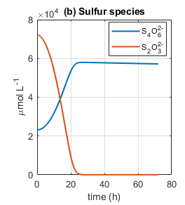
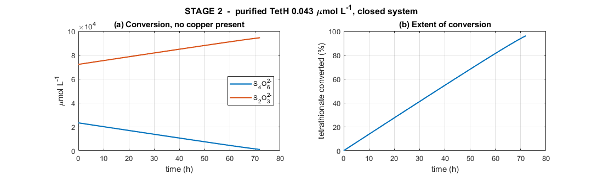
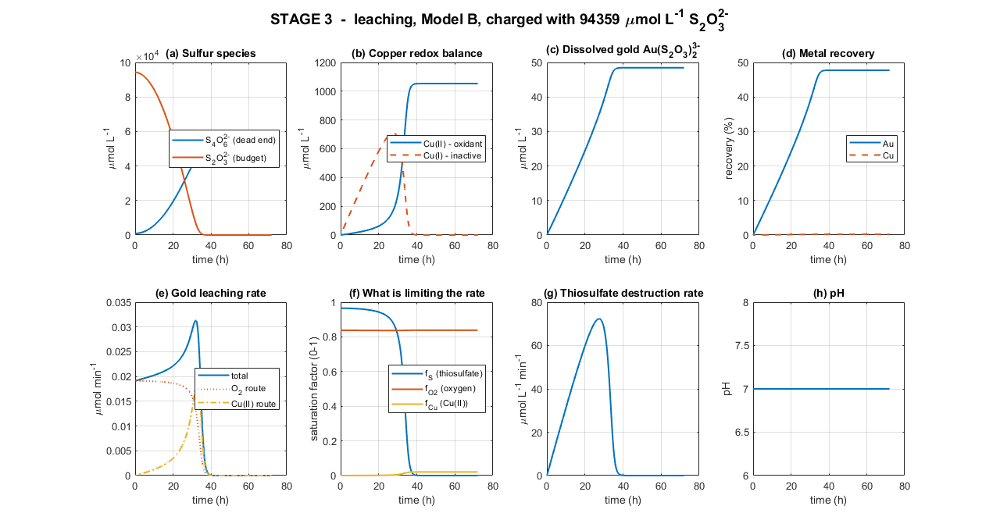
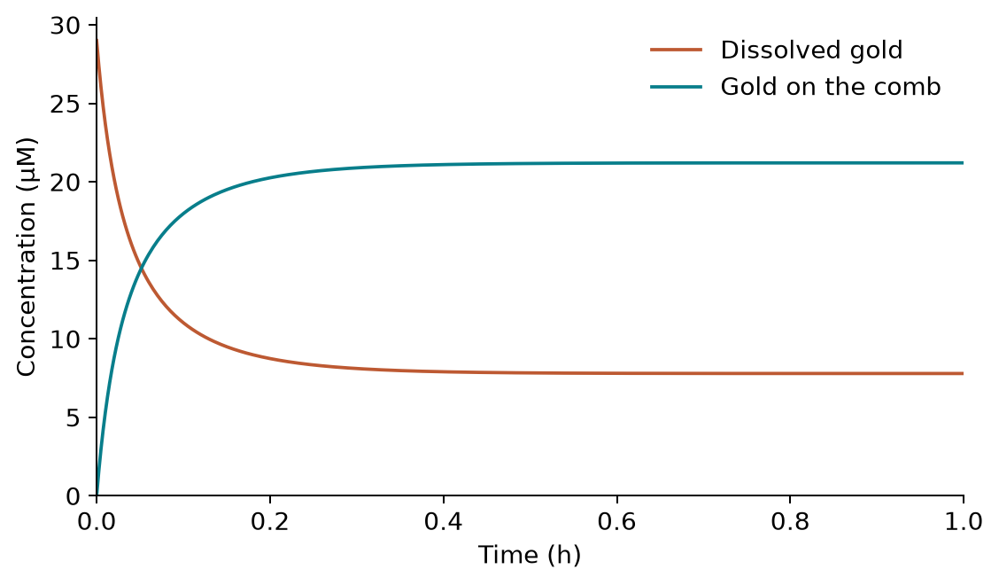
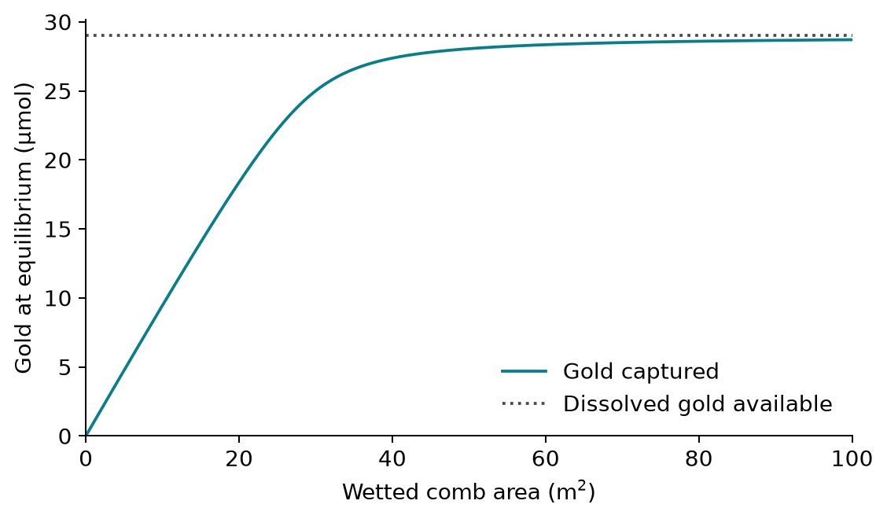
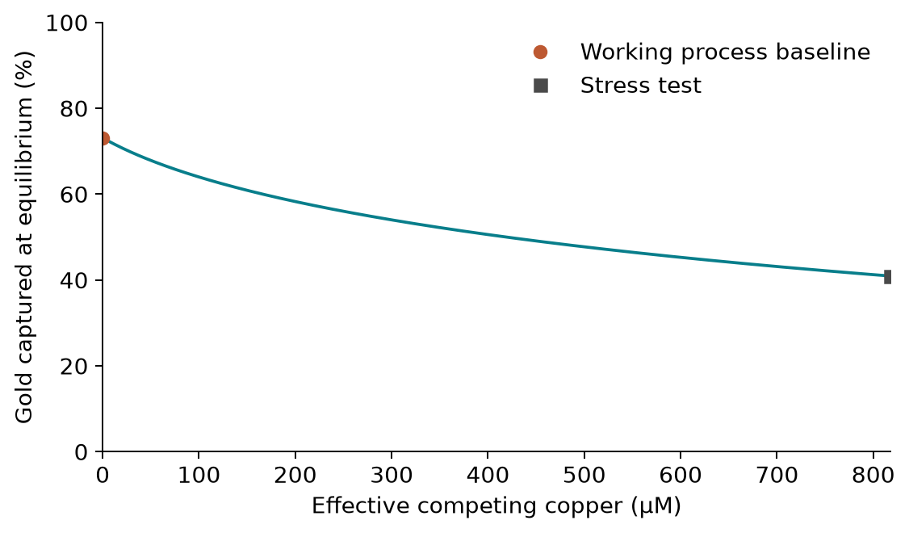
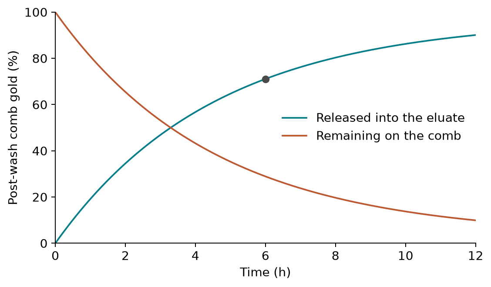
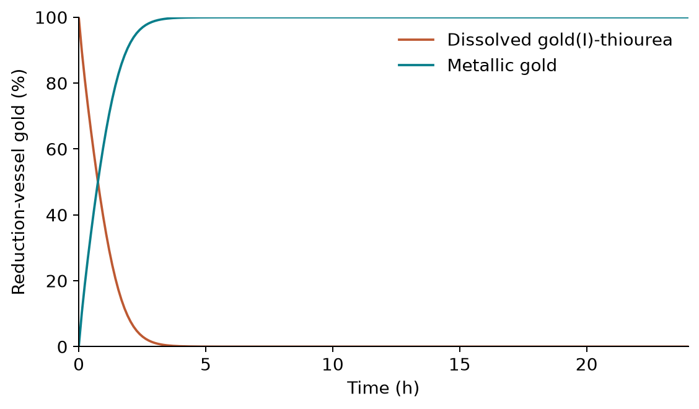

<!--
Tier 3. Intake file for the rewritten public Model wiki.
The user supplies the content. It is authoritative. Nothing in this repository
and nothing on the current wiki overrides it.
[V] = must stay visible.  [D] = may sit in a labelled dropdown.
-->

# Model

## Overview [V]

### The question [V]

Recovering gold from e-waste: can engineered *E. coli* effectively recover
gold from electronic waste?

### Process overview [V]

From electronic waste to metallic gold

Figure: `01-overview-process.png`. Title: Five stages, one chain.

Caption: Make thiosulfate -> leach crushed PCB -> capture dissolved gold ->
release it with thiourea -> return it to metallic gold.

### Introduction [V]

Electronic waste contains valuable metals that are difficult to recover
selectively and sustainably. This project proposes an engineered *E.
coli*-supported process that produces a thiosulfate leachant, dissolves gold
from printed circuit boards, captures the dissolved gold using surface-displayed
GolB, releases it with thiourea, and reduces it back to metallic gold.

Modelling connects this biological process to both the wet-lab experiments and
the hardware used to operate it, translating biological behaviour into
operating conditions, equipment requirements, and measurable design decisions.
Throughout the project, the models have guided decisions in the wet lab and in
hardware, and have helped us engineer the process for scale.

The models follow gold through each stage, from the thiosulfate leachant to the
recovered metal.

---

## Stage 1: Biological Input (Enzymes) [V]

### Question [V]

How can bacteria produce thiosulphate?

### In plain language [V]

Gold must first be dissolved before it can be captured. Our process uses
thiosulfate for this job, so the first modelling stage asks how the
engineered cells can supply TetH and how that enzyme can prepare the
leachant.

Bacteria produce tetrathionate hydrolase, an enzyme that breaks down
tetrathionate to thiosulphate, which is then extracted and purified. It
is modelled by a protein production model.

bacteria → TetH enzyme (E)

### Model and assumptions [V]

It is modelled by a protein production model with synthesis,
degradation, and dilution.

- Enzyme synthesis rate is linear.

- Constant bacterial biomass.

- Enzyme production occurs at optimised bacterial growth conditions.

### Finding [V]

Using standard E. coli protein synthesis parameters, the culture reaches
steady state in 55 minutes. A litre of culture yields approximately
7.791 × 10⁻³ µmol L⁻¹ of TetH, if using generic E. Coli values for the
enzyme production, equivalent to about 4692 molecules per cell — roughly
0.5% of the cell's total protein, which is a modest and realistic
burden.

### Project impact [V]

The culture volume required to charge one litre of Stage 2 to a target
enzyme concentration E₂ follows directly. The enzyme concentration
needed can change.

``` math
\frac{V_{culture}}{V_{stage\ 2}\ }\  = \ \frac{E_{2}}{\lbrack E\rbrack_{culture}}
```

### Next experiment [V]

TBD

### Derivation [D]

Transient:
$`\frac{d\lbrack E\rbrack}{dt}\ \  = \ \ k_{syn}\  \cdot \ X\ \  - \ \ (k_{\deg}\  + \ \mu)\  \cdot \ E`$

Steady State:
$`\lbrack E\rbrack_{culture}\ \  = \ \ \frac{k_{syn}\  \cdot \ X}{k_{\deg} + \ \mu}\ \`$

### Parameters [D]

#### Stage 1A

|  |  |  |  |
|:--:|:--:|:--:|:--:|
| **Symbol** | **Meaning** | **Unit** | **Value / source** |
| \[E\] | Active TetH in the culture | µmol L⁻¹ | 4.75×10⁻³ (steady state) |
| X | Biomass concentration | cell L⁻¹ | 1×10¹² |
| k_syn | Enzyme synthesis rate per cell | µmol cell⁻¹ min⁻¹ | $`1.43356\  \times 10^{- 16}`$(cascade-matched) \[17\] |
| k_deg | Enzyme degradation rate | min⁻¹ | 1.1×10⁻³ \[4\] |
| Μ | Growth-dilution rate | min⁻¹ | 0.0173 (40 min doubling) \[16\] |
| **Symbol** | **Meaning** | **Unit** | **Value / source** |

---

## Stage 2: Output (Thiosulphate) [V]

### Question [V]

### In plain language [V]

TetH converts tetrathionate to thiosulphate in the reaction below.

S₄O₆²⁻ + H₂O → S₂O₃²⁻ + S⁰ + SO₄²⁻ + 2H⁺

### Model and assumptions [V]

Thiosulphate follows a Michaelis-Menten enzyme model, with a constant
enzyme concentration.

Initial conditions are based on tetrathionate broth production protocol
stoichiometry. Final values are below.

30 g/L ÷ 248.18 g/mol = 120.88 mmol S₂O₃²⁻ 6 g ÷ 253.81 g/mol = 23.64
mmol I₂

→ S₄O₆²⁻ = 23.64/1.02 = 23.2 mM S₂O₃²⁻ = (120.88 − 47.28)/1.02 = 72.1 mM

- Enzymes produced in the previous stage are extracted with 100%
  efficiency.

- Enzymes are operating in optimal conditions (temperature, pH,
  agitation rate).

- Initial conditions from tetrathionate broth stoichiometry.

- Only the reactions of interest occur in non-negligible amounts. All
  other sulphur species are relevant or present.

- All produced sulphur species are stable and do not degrade or oxidise
  over the conversion period.

### Finding [V]

In a simultaneous model, tetrathionate concentration does not fall as
expected, but rises from due to Cu (II)’s parasitic reaction with
thiosulphate. This reaction, along with leaching, uses up thiosulphate.
This implies that parasitic tetrathionate regeneration has a greater
impact on tetrathionate than enzymatic conversion, making it harder to
produce a large batch of thiosulphate. This creates a futile cycle: the
enzyme converts S₄O₆²⁻ into S₂O₃²⁻, and Cu (II) converts S₂O₃²⁻ straight
back into S₄O₆²⁻.

With a sequential model, the reaction is zero-order and looks linear
rather than exponential. Tetrathionate concentration decreases, while
thiosulphate concentration rises. The final product is 94.4 mM
thiosulphate, which is close to the 0.1 M concentration reported as
optimal for thiosulfate gold leaching. Thus, the sequential model was
chosen?

Simultaneous Model:



Sequential Model:



### Project impact [V]

- Should tetrathionate conversion occur in the same bioreactor as the
  PCB leaching?

- How long should the conversion process be?

The set enzyme concentration from stage 1 determines the number of
litres and time taken for maximum thiosulphate concentration. For
example, an enzyme concentration of E₂ = 0.043 µmol L⁻¹ takes a total
conversion of 3 days and needs 9.1 L of culture per litre compared to E₂
=0.129 µmol L⁻¹, which takes 1 day but needs 27 L of culture.

### Next experiment [V]

TBD

### Derivation [D]

``` math
v = \frac{k_{cat} \bullet E_{2} \bullet \left\lbrack S_{4}O_{6}^{2 -} \right\rbrack}{\left( K_{m} + \ \left\lbrack S_{4}O_{6}^{2 -} \right\rbrack \right)}
```

If thiosulphate production and PCB leaching are done in separate
bioreactors, the rate of change between sulphur species are the
following:

``` math
\frac{d\left\lbrack S_{4}O_{6}^{2 -} \right\rbrack}{dt} = - v\ ;\ \frac{d\left\lbrack S_{2}O_{3}^{2 -} \right\rbrack}{dt} = v
```

If thiosulphate production and PCB leaching are done in the same
bioreactor, additional terms are needed to model the effect of gold
leaching, copper leaching, and copper parasitic reactions on
tetrathionate and thiosulphate.

``` math
\frac{d\left\lbrack S_{4}O_{6}^{2 -} \right\rbrack}{dt} = \  - v + \ R_{Cu,\ para}
```

$`\frac{d\left\lbrack S_{2}O_{3}^{2 -} \right\rbrack}{dt}`$
$`\  = v - R_{Cu,\ para} - \left( \frac{2}{V} \right) \cdot R_{Au} - \left( \frac{1}{V} \right) \cdot R_{Cu}`$

### Parameters [D]

#### Stage 1B

| \[S₄O₆²⁻\] | Tetrathionate concentration | µmol L⁻¹ | state variable; initial 23 200 |
|:--:|:--:|:--:|:--:|
| \[S₂O₃²⁻\] | Thiosulfate concentration | µmol L⁻¹ | state variable; initial 72 100 |
| E₂ | Purified TetH in the conversion vessel | µmol L⁻¹ | 0.043 (design variable) |
| k_cat | Turnover number of TetH | min⁻¹ | 125 (2.5 U mg⁻¹ × 50 kDa) \[1\]\[2\] |
| K_m | Michaelis constant | µmol L⁻¹ | 300 (species range 50–2400) \[2\] |
| Y | Stoichiometric yield (S₂O₃ per S₄O₆) | — (dimensionless) | 1 \[1\] |
| t₂ | Stage-2 duration | Min | 4 320 (3 days) |

---

---

## Stage 3: Leaching Gold [V]

### Question [V]

### In plain language [V]

The thiosulphate from Stage 1 is mixed with crushed PCB powder to
produce leached gold ions. Gold can be oxidised directly by oxygen or by
Cu(II).

4Au⁰ + 8S₂O₃²⁻ + O₂ + 2H₂O → 4Au(S₂O₃)₂³⁻ + 4OH⁻ (O₂ route)

Au⁰ + 2S₂O₃²⁻ + Cu(II) → Au(S₂O₃)₂³⁻ + Cu(I) (Cu(II) route)

However, thiosulphate also leaches other metals, the most prominent
being copper. Copper can also be oxidised directly by oxygen or by
Cu(II).

4Cu⁰ + O₂ + 8S₂O₃²⁻ + 2H₂O → 4\[Cu(S₂O₃)₂\]³⁻ + 4OH⁻ (O₂ route)

Cu⁰ + Cu²⁺ + 4S₂O₃²⁻ → 2\[Cu(S₂O₃)₂\]³⁻ (Cu(II) route)

Copper ions also react with themselves and thiosulphate in other
auxiliary reactions.

4Cu(I) + O₂ + 2H₂O → 4Cu(II) + 4OH⁻ (re-oxidation)

2Cu(II) + 2S₂O₃²⁻ → 2Cu(I) + S₄O₆²⁻ (parasitic)

### Model and assumptions [V]

A Langmuir surface kinetics model with a shrinking surface area was used
to model gold leaching as thiosulphate particles have to interact with
limited metallic gold surface areas over time. Parallel pathways were
used to represent the use of both oxygen and Cu(II) as oxidants.

Copper Leaching:

Copper was modelled as two ions: Cu(I) and Cu(II). Copper leaching
action was modelled with a similar Langmuir surface kinetics model with
parallel pathways for oxygen and Cu(II) oxidants. A shrinking core model
was used since copper appears in bulk in PCBs compared to gold, which
appears as thin plates on minimal parts of the PCBs. Mass action kinetic
models were used for the other copper reactions.

Initial conditions are based on Stage 1’s final tetrathionate and
thiosulphate values.

- Metallic gold is assumed to be a shrinking surface area due to its
  presence as thin metal surfaces.

- Metallic copper is assumed to be a shrinking volume due to its large
  presence in PCBs.

- Environmental conditions (pH, temperature, pulp density, agitation
  rate, etc) are optimised for gold leaching.

- There are idealised physics conditions such perfect mixing, no
  mass-transfer resistance, uniform spherical particles with no
  agglomeration, isothermal operation, and a uniform gold film thickness
  across all particles)

- All complexes are stable and do not degrade naturally.

- Other metals are leached in negligible amounts and have little impact
  on thiosulphate concentrations.

### Finding [V]

When no ammonia is present, the Cu(II) oxidation rout is effectively
null. Gold leaching is minimal, with only 19.69% in 24h and 28.93%
leached in 72 hours. When ammonia is present (approximately 260 mM), the
Cu(II) oxidant route activates, and thus gold leaching is more
effective, with 36.6% metallic gold leached in 24h, and 40.97% leached
as a maximum in 29h. This supports the decision to design around a
one-day batch rather than assuming that a three-day residence time is
automatically better.

Both models show that the thiosulphate is the limiting reagent in gold
leaching due to parasitic regeneration of tetrathionate. Ammonia acted
as lixiviant for copper, but had minimal impact, with only 0.0017%
increase in the thiosulphate share allotted to gold leaching.

W/o ammonia \[0 mM\]

![W/o ammonia \[0 mM\]](media/bioleaching/stage2-no-ammonia.png)

W/ Ammonia \[260 mM\]

![W/ Ammonia \[260 mM\]](media/bioleaching/stage2-ammonia-260mM.png)

Previous ammonia models for Design Questions 1 and 2 assumed excess
oxygen. Assuming a rate-limited oxygen supply based on
kL<sub>A</sub>,oxygen woul oxygen concentration \[O<sub>2</sub>\] can be
modelled with the equation below.


With a rate-limited oxygen, it seems that a greater share of
thiosulphate is used for gold leaching, with a 7% increase in maximum
gold leaching since there is less oxygen to convert Cu(I) to Cu(II).
However, it comes at a cost of time, with a limited oxygen rate
extending leaching time by 8-9 hours.



### Project impact [V]

- Should oxygen be the only oxidant?

- Should ammonia be added as copper lixiviant?

- Should oxygen be in excess or rate-limited?

### Next experiment [V]

TBD

### Derivation [D]

Gold Leaching:

``` math
R_{Au}\  = \ A_{Au}(t) \cdot \frac{\left\lbrack S_{2}O_{3}^{2 -} \right\rbrack}{K_{S} + \left\lbrack S_{2}O_{3}^{2 -} \right\rbrack}\ \  \cdot \ \left\lbrack k_{Au,O_{2}} \cdot \frac{\left\lbrack O_{2} \right\rbrack}{K_{O_{2}} + \left\lbrack O_{2} \right\rbrack}\  + \ k_{Au,Cu} \cdot \frac{\left\lbrack Cu(II) \right\rbrack}{K_{Cu} + \left\lbrack Cu(II) \right\rbrack}\  \right\rbrack
```

``` math
\frac{dn_{Au}}{dt}\  = \  - R_{Au}
```

``` math
\ \ \ \ \ \ \ \ d\frac{\left\lbrack AuO_{3}^{2 -} \right\rbrack}{dt}\  = \  + \frac{R_{Au}}{V}
```

.

``` math
v_{1B}\  = \ A_{Cu}(t) \cdot \frac{\left\lbrack S_{2}O_{3}^{2 -} \right\rbrack}{K_{S} + \left\lbrack S_{2}O_{3}^{2 -} \right\rbrack} \cdot \{\ {2k}_{Cu,O_{2}} \cdot \frac{\left\lbrack O_{2} \right\rbrack}{K_{O_{2}} + \left\lbrack O_{2} \right\rbrack}\  + \ {4k}_{Cu,\ \ Cu^{2 +}} \cdot \frac{\left\lbrack Cu(II) \right\rbrack}{K_{Cu} + \left\lbrack Cu(II) \right\rbrack}\ \}\ 
```

``` math
v₂\  = \ R_{Au}\ 
```

``` math
v₃\  = \ k₃ \cdot \lbrack Cu(II)\rbrack \cdot \lbrack S₂O₃²⁻\rbrack
```

``` math
v₄\  = \ k₄ \cdot \lbrack O₂\rbrack \cdot \lbrack Cu(I)\rbrack
```

``` math
d\frac{\left\lbrack Cu(II) \right\rbrack}{dt}\  = \ 4 \cdot v₄\  - \ \left( \frac{1}{V} \right) \cdot v₁B\  - \ \left( \frac{1}{V} \right) \cdot v₂\  - \ 2 \cdot v₃
```

``` math
\frac{d\left\lbrack Cu(I) \right\rbrack}{dt}\  = \ \left( \frac{1}{V} \right) \cdot 2 \cdot v₁B\  + \ \left( \frac{1}{V} \right) \cdot v₂\  + \ 2 \cdot v₃\  - \ 4 \cdot v₄
```

``` math
\frac{d\lbrack O_{2}\rbrack}{dt} = kLA \times \left( C^{*} - \left\lbrack O_{2} \right\rbrack \right) - \left( \frac{0.25R_{Au} + 0.25R_{cu}}{4V} + 0.25v_{4} \right)
```

### Parameters [D]

#### Stage 2

| **Symbol** | **Meaning** | **Unit** | **Value / source** |
|:--:|:--:|:--:|:--:|
| n_Au | Solid gold remaining | µmol | state variable; initial 101.5 |
| n_Cu | Solid copper remaining | µmol | state variable; initial 472 069 |
| A_Au | Exposed gold area (thin film, constant) | m² | 2.07×10⁻³ |
| A_Cu | Exposed copper area (shrinking particle) | m² | 3.35×10⁻³ initial |
| m_Au / m_Cu | Metal mass on the boards | Kg | 20×10⁻⁶ / 30×10⁻³ (100 g L⁻¹ PCB) |
| ρ_Au / ρ_Cu | Metal densities | kg m⁻³ | 19 300 / 8 960 |
| t_film | Gold plating thickness | M | 0.5×10⁻⁶ |
| D | Crushed particle size | M | 6×10⁻³ |
| k_Au,O₂ | Gold rate constant, O₂ route | µmol m⁻² min⁻¹ | 6 \[9\]\[10\] |
| k_Au,Cu | Gold rate constant, Cu(II) route | µmol m⁻² min⁻¹ | 21.0 (ammonia-free) \[20\] / 1500 (with ammonia) \[11\]\[12\] |
| k_Cu,O₂ / k_Cu,Cu | Copper rate constants | µmol m⁻² min⁻¹ | 200 / 200 \[13\] |
| K_O₂ | O₂ half-saturation | µmol L⁻¹ | 50 \[10\] |
| K_S | Thiosulfate half-saturation | µmol L⁻¹ | 3,376 (= 1/K_ads) \[18\] |
| K_Cu | Cu(II) half-saturation | µmol L⁻¹ | 5×10⁴ \[12\] |
| k₁, k₃ | Parasitic rate constants | L µmol⁻¹ min⁻¹ | 1.20×10⁻⁵ (ammonia-free)/ 1×10⁻⁵ (with ammonia) \[6\]\[7\] |
| k₄ | Cu(I) re-oxidation rate constant | L µmol⁻¹ min⁻¹ | 1×10⁻⁴ \[7\] |
| \[O₂\] | Dissolved oxygen (held constant) | µmol L⁻¹ | 500 |

<table>
<colgroup>
<col style="width: 7%" />
<col style="width: 5%" />
<col style="width: 4%" />
<col style="width: 16%" />
<col style="width: 16%" />
<col style="width: 50%" />
</colgroup>
<thead>
<tr>
<th style="text-align: center;">Rpm</th>
<th colspan="2" style="text-align: center;">Stirrer rotation speed</th>
<th style="text-align: center;">600 (example)</th>
<th style="text-align: center;">rev/min</th>
<th style="text-align: center;">Equipment specs</th>
</tr>
</thead>
<tbody>
<tr>
<td style="text-align: center;">N_p</td>
<td colspan="2" style="text-align: center;">Shaped-based power
number</td>
<td style="text-align: center;">5.0</td>
<td style="text-align: center;">dimensionless</td>
<td style="text-align: center;">Standard engineering constant for a
Rushton turbine (a flat-bladed disc impeller); tabulated in mixing
handbooks (e.g. Van't Riet's own paper, and standard bioreactor
engineering references like Garcia-Ochoa &amp; Gomez 2009)</td>
</tr>
<tr>
<td style="text-align: center;">Ρ</td>
<td colspan="2" style="text-align: center;">Density of the liquid being
stirred</td>
<td style="text-align: center;">1000</td>
<td style="text-align: center;">kg/m³</td>
<td style="text-align: center;">Standard physical constant for water at
~25°C</td>
</tr>
<tr>
<td style="text-align: center;">D_i</td>
<td colspan="2" style="text-align: center;">Impeller diameter</td>
<td style="text-align: center;">0.04</td>
<td style="text-align: center;">m</td>
<td style="text-align: center;">Equipment specs</td>
</tr>
<tr>
<td style="text-align: center;">V</td>
<td colspan="2" style="text-align: center;">Working liquid volume</td>
<td style="text-align: center;">0.001 (= 1 L)</td>
<td style="text-align: center;">m³</td>
<td style="text-align: center;">Equipment specs</td>
</tr>
<tr>
<td style="text-align: center;">0.6</td>
<td colspan="2" style="text-align: center;">Gassing correction
factor</td>
<td style="text-align: center;">0.6</td>
<td style="text-align: center;">dimensionless</td>
<td style="text-align: center;">Empirical rule of thumb from bioreactor
engineering literature</td>
</tr>
<tr>
<td style="text-align: center;">P/V</td>
<td colspan="2" style="text-align: center;">Power input per unit
volume</td>
<td style="text-align: center;">307.2 (calculated)</td>
<td style="text-align: center;">W/m³</td>
<td style="text-align: center;">Derived from the equation above</td>
</tr>
<tr>
<td colspan="2" style="text-align: center;"><strong>Symbol</strong></td>
<td colspan="2"
style="text-align: center;"><strong>Meaning</strong></td>
<td style="text-align: center;"><strong>Unit</strong></td>
<td style="text-align: center;"><strong>Value / source</strong></td>
</tr>
<tr>
<td colspan="2" style="text-align: center;">[O₂]</td>
<td colspan="2" style="text-align: center;">Dissolved oxygen
concentration</td>
<td style="text-align: center;">µmol L⁻¹</td>
<td style="text-align: center;"><strong>state variable; initial
259</strong> (air-saturated water at t=0 — see note below)</td>
</tr>
<tr>
<td colspan="2" style="text-align: center;">Q_air</td>
<td colspan="2" style="text-align: center;">Air pump flow rate</td>
<td style="text-align: center;">L min⁻¹</td>
<td style="text-align: center;">Equipment specs</td>
</tr>
<tr>
<td colspan="2" style="text-align: center;">Rpm</td>
<td colspan="2" style="text-align: center;">Stirrer rotation speed</td>
<td style="text-align: center;">rev min⁻¹</td>
<td style="text-align: center;">Equipment specs</td>
</tr>
<tr>
<td colspan="2" style="text-align: center;">D_T</td>
<td colspan="2" style="text-align: center;">Tank internal diameter</td>
<td style="text-align: center;">M</td>
<td style="text-align: center;">Equipment specs</td>
</tr>
<tr>
<td colspan="2" style="text-align: center;">D_i</td>
<td colspan="2" style="text-align: center;">Impeller diameter</td>
<td style="text-align: center;">M</td>
<td style="text-align: center;">Equipment specs</td>
</tr>
<tr>
<td colspan="2" style="text-align: center;">V</td>
<td colspan="2" style="text-align: center;">Working liquid volume</td>
<td style="text-align: center;">m³</td>
<td style="text-align: center;">Equipment specs</td>
</tr>
<tr>
<td colspan="2" style="text-align: center;">A_x</td>
<td colspan="2" style="text-align: center;">Tank cross-sectional
area</td>
<td style="text-align: center;">m²</td>
<td style="text-align: center;">7.854×10⁻³ [Derived]</td>
</tr>
<tr>
<td colspan="2" style="text-align: center;">u_g</td>
<td colspan="2" style="text-align: center;">Superficial gas
velocity</td>
<td style="text-align: center;">m s⁻¹</td>
<td style="text-align: center;">1.06×10⁻³ (= Q_air/A_x, derived)</td>
</tr>
<tr>
<td colspan="2" style="text-align: center;">N_p</td>
<td colspan="2" style="text-align: center;">Power number (impeller shape
factor)</td>
<td style="text-align: center;">—</td>
<td style="text-align: center;">5.0; standard constant for a Rushton
turbine [Van't Riet 1979]</td>
</tr>
<tr>
<td colspan="2" style="text-align: center;">Ρ</td>
<td colspan="2" style="text-align: center;">Liquid density</td>
<td style="text-align: center;">kg m⁻³</td>
<td style="text-align: center;">1000; standard physical constant, water
at 25°C</td>
</tr>
<tr>
<td colspan="2" style="text-align: center;">gassing factor</td>
<td colspan="2" style="text-align: center;">Power reduction under
aeration</td>
<td style="text-align: center;">—</td>
<td style="text-align: center;">0.6;[Garcia-Ochoa &amp; Gomez 2009]</td>
</tr>
<tr>
<td colspan="2" style="text-align: center;">P/V</td>
<td colspan="2" style="text-align: center;">Power input per unit
volume</td>
<td style="text-align: center;">W m⁻³</td>
<td style="text-align: center;">307.2 [Derived]</td>
</tr>
<tr>
<td colspan="2" style="text-align: center;">kLa</td>
<td colspan="2" style="text-align: center;">Volumetric O₂ mass transfer
coefficient</td>
<td style="text-align: center;">min⁻¹</td>
<td style="text-align: center;">1.68 [Derived] [Van't Riet 1979]</td>
</tr>
<tr>
<td colspan="2" style="text-align: center;">C*</td>
<td colspan="2" style="text-align: center;">O₂ saturation concentration
(air, 25°C)</td>
<td style="text-align: center;">µmol L⁻¹</td>
<td style="text-align: center;">259 [APHA Standard Methods DO tables;
cross-checked via Henry's Law, k_H=769 L·atm/mol]</td>
</tr>
</tbody>
</table>

### References [D]

Y. Kanao et al., "Tetrathionate hydrolase from the acidophilic
microorganisms," Front. Microbiol., vol. 15, 1338669, 2024.

**\[2\]** Y. Kanao, K. Kamimura, and T. Sugio, "Purification of a
tetrathionate hydrolase from Acidithiobacillus ferrooxidans," J.
Biotechnol., vol. 132, pp. 16–22, 2007.

**\[3\]** U. Alon, An Introduction to Systems Biology, 2nd ed. Boca
Raton, FL: CRC Press, 2019.

**\[4\]** M. R. Maurizi, "Proteases and protein degradation in
Escherichia coli," Experientia, vol. 48, pp. 178–201, 1992.

**\[5\]** G. E. Briggs and J. B. S. Haldane, "A note on the kinetics of
enzyme action," Biochem. J., vol. 19, pp. 338–339, 1925.

**\[6\]** J. J. Byerley, S. A. Fouda, and G. L. Rempel, "Kinetics and
mechanism of the oxidation of thiosulphate ions by copper(II) ions in
aqueous ammonia solution," J. Chem. Soc. Dalton Trans., pp. 889–893,
1973.

**\[7\]** P. L. Breuer and M. I. Jeffrey, "The reduction of copper(II)
and the oxidation of thiosulfate and oxysulfur anions in gold leaching
solutions," Hydrometallurgy, vol. 70, pp. 163–173, 2003.

**\[8\]** G. Senanayake, "Analysis of reaction kinetics, speciation and
mechanism of gold leaching and thiosulfate oxidation by ammoniacal
copper(II) solutions," Hydrometallurgy, vol. 75, pp. 55–75, 2004.

**\[9\]** S. Zhang and M. J. Nicol, "An electrochemical study of the
dissolution of gold in thiosulfate solutions Part I: Alkaline
solutions," J. Appl. Electrochem., vol. 33, pp. 767–775, 2003.

**\[10\]** O. Sitando et al., "A review of factors affecting gold
leaching in non-ammoniacal thiosulfate solutions," Hydrometallurgy, vol.
178, pp. 151–175, 2018.

**\[11\]** M. G. Aylmore and D. M. Muir, "Thiosulfate leaching of gold —
a review," Miner. Eng., vol. 14, no. 2, pp. 135–174, 2001.

**\[12\]** D. Maharaj, T. Moyo, and J. Petersen, "Ammonium thiosulfate
leaching of gold from electronic printed circuit boards," J. S. Afr.
Inst. Min. Metall., vol. 124, no. 12, pp. 711–718, 2024.

**\[13\]** E. Salinas-Rodríguez et al., "Leaching of copper contained in
waste printed circuit boards using the thiosulfate–oxygen system,"
Materials, vol. 15, no. 7, 2354, 2022.

**\[14\]** O. Levenspiel, Chemical Reaction Engineering, 3rd ed. New
York, NY: Wiley, 1999.

**\[15\]** P. L. Breuer and M. I. Jeffrey, "An electrochemical study of
gold leaching in thiosulfate solutions containing copper and ammonia,"
Hydrometallurgy, vol. 65, pp. 145–157, 2002.

**\[16\]** H. Bremer and P. P. Dennis, "Modulation of chemical
composition and other parameters of the cell at different exponential
growth rates," EcoSal Plus, vol. 3, no. 1, 2008.

**\[17\]** R. Milo et al., "BioNumbers — the database of key numbers in
molecular and cell biology," Nucleic Acids Res., vol. 38, pp. D750–D753,
2010.

**\[18\]** G. Senanayake, "A surface adsorption/reaction mechanism for
gold oxidation by copper(II) in ammoniacal thiosulfate solutions," J.
Colloid Interface Sci., vol. 286, pp. 253–257, 2005.

**\[19\]** T. Kanao et al., "Recombinant tetrathionate hydrolase from
Acidithiobacillus ferrooxidans requires exposure to acidic conditions
for proper folding," FEMS Microbiol. Lett., vol. 309, no. 1, pp. 43–47,
2010.

## Stage 4: Capturing Dissolved Gold [V]

### Question [V]

### In plain language [V]

Gold enters the stage mainly as gold-thiosulfate. GolB binds metal through the
two cysteine sulfur atoms in its Cys-X-X-Cys motif. The capture chemistry is
represented by the simplified reaction scheme:

    Au(S₂O₃)₂³⁻ + GolB-(SH)₂ ⇌ Au-GolB + released thiosulfate

Copper able to bind GolB can occupy the same effective capacity:

    Cu_effective + GolB-(SH)₂ ⇌ Cu-GolB

A capacity occupied by copper is unavailable to gold. The simplified model
therefore represents copper as an effective reversible competitor. Permanent
damage to GolB is assumed negligible.

### Model and assumptions [V]

| # | Assumption | Why it is used | Consequence if it is wrong |
|---:|---|---|---|
| 1 | The liquid is well mixed and its volume is constant. | This keeps the model to binding rather than fluid transport. | Poor mixing makes the predicted capture time too short. |
| 2 | One completely covered cell layer supplies `ρ_X = 0.212 g/m²`. | It connects comb geometry to biomass before hardware measurements exist. | Capacity changes in direct proportion to the true attached biomass density. |
| 3 | `q_Au = 4.62 µmol/g` transfers to the project comb. | It is the closest whole-cell GolB loading measurement [S76](SOURCES.md). | Every predicted comb capacity changes in direct proportion to the measured project value. |
| 4 | Gold and effective copper bind one shared class of sites reversibly. | It gives the smallest model that represents competition. | Multiple site classes or irreversible binding change the competition curve. |
| 5 | Permanent GolB damage is negligible. | No project measurement currently quantifies it. | Site damage would lower `[S_total]` and make both capture scenarios optimistic. |
| 6 | The working baseline contains no effective competing copper. | The upstream late-handoff copper is modelled as Cu(II), not Cu(I). | Residual competing copper moves the result from the baseline toward the stress-test curve. |
| 7 | The GolS gold/copper selectivity transfers to GolB, giving `K_Cu = α K_Au = 36.4 µM`. | No matched GolB gold/copper measurement exists, and GolS is the closest matched experiment [S79](SOURCES.md). | A different true GolB selectivity moves the whole competition curve, and with it the `40.93%` stress-test result. |
| 8 | Effective copper competition reaches equilibrium within the capture contact. | Cu(I) binding to related Cys-X-X-Cys proteins is complete in seconds [S80](SOURCES.md), while the contact lasts hours. | If copper binds slowly, early capture would retain more gold than the equilibrium competition graph shows. |

The cost of assumptions 2 and 3 is especially direct: their product sets the
capacity per square metre. They should therefore be replaced first.

### Finding [V]

The stage uses two separate graphs:

1. **Capture over time.** The comb transfers gold from the liquid to GolB until
   the available capacity approaches equilibrium.
2. **Capacity against comb area.** Increasing wetted area increases capture
   only until the dissolved-gold inventory becomes limiting.



*Figure 1. Capture over time. The comb transfers gold from the liquid to GolB
until the available capacity approaches equilibrium.*



*Figure 2. Capacity against comb area. Increasing wetted area increases
capture only until the dissolved-gold inventory becomes limiting.*

After introducing competition, a third graph shows equilibrium gold capture
against `[Cu_effective]₀`. The main process baseline uses
`[Cu_effective]₀ = 0 µM` because the upstream model predicts Cu(II), rather
than competing Cu(I), at the late handoff. The `818 µM` case deliberately
treats the upstream model's peak Cu(II) inventory as though it could all
compete reversibly. It is therefore an upper-bound stress test, not the
expected feed composition [Part I result](REVIEW.md#the-leach-vessel).



*Figure 3. Equilibrium gold capture against `[Cu_effective]₀`. The `818 µM`
case is an upper-bound stress test, not the expected feed composition.*

For the reference case, the competition model gives:

| Case | Gold captured at equilibrium | Interpretation |
|---|---:|---|
| No effective competing copper | 73.14% | Working process baseline |
| `818 µM` effective competing copper | 40.93% | Deliberately conservative stress test |

### Project impact [V]

The downstream production-design calculation uses `A_wet = 23.6 m²`. This is
the surface area carried into capture, elution and reduction; it is not the
current hardware. The current twelve `7 cm × 3 cm` combs provide `0.0504 m²`
when both broad faces are counted. The wet
lab should prioritise attached biomass density, comb gold loading and elution
measurements because these quantities control the largest losses.

The copper stress test is a robustness question, not the process baseline. It
shows that capture could fall from `73.14%` to `40.93%` if the full upstream
copper inventory behaved as a reversible GolB competitor. This result supports
measuring copper speciation at the handoff rather than designing the whole
process around the stress case.

### Next experiment [V]

`K_Au = 0.7 µM` comes from soluble GolB, while `α = 52` comes from a matched
GolS gold/copper response [S78–S79](SOURCES.md). The project should measure:

1. Attached dry biomass per unit wetted area and its growth over time.
2. Gold remaining in the liquid and gold retained by the comb over time.
3. A gold-loading isotherm in the filtered project liquid.
4. Gold capture with and without copper under the same solution conditions.
5. Gold and copper lost during washing.

### Derivation [D]

#### Connecting the comb to capture capacity

At complete surface coverage, the attached biomass is:

    m_X = ρ_X A_wet

The maximum effective gold loading of that biomass is:

    Q_Au,comb = q_Au m_X

The effective capacity used in the concentration model is:

    [S_total] = Q_Au,comb / V_capture

The working literature value is `q_Au = 4.62 µmol/g dry cells` [S76](SOURCES.md).
The area therefore controls how much biomass the hardware supports, while
`q_Au` controls the capacity of that biomass.

With `ρ_X = 0.212 g/m²` and complete coverage, one square metre supplies:

    4.62 µmol/g × 0.212 g/m² = 0.979 µmol Au/m²

#### Time-dependent capture model

The gold-binding rate is:

    r_Au = k_on,Au[Au][S_free] − k_off,Au[Au-GolB]

Gold in solution and gold on the comb change together:

    d[Au]/dt = −r_Au

    d[Au-GolB]/dt = r_Au

The equivalent copper equations are:

    r_Cu = k_on,Cu[Cu_effective][S_free] − k_off,Cu[Cu-GolB]

    d[Cu_effective]/dt = −r_Cu

    d[Cu-GolB]/dt = r_Cu

Both metals draw from the same capacity:

    [S_free] = [S_total] − [Au-GolB] − [Cu-GolB]

At the start of capture:

    [Au-GolB]₀ = 0

    [Cu-GolB]₀ = 0

The main time graph uses the gold-only working model with `k_on,Au =
1.0 µM⁻¹ h⁻¹` [S57](SOURCES.md), `K_Au = 0.7 µM` [S78](SOURCES.md) and:

    k_off,Au = K_Au k_on,Au = 0.7 h⁻¹

Copper equilibrates in seconds [S80](SOURCES.md), so no time-varying copper
curve is plotted. Copper appears only in the equilibrium competition graph, at
different effective competing copper concentrations.

#### Equilibrium capture

At equilibrium:

    [Au-GolB]_eq =
        [S_total] × ([Au]_eq/K_Au)
        / (1 + [Au]_eq/K_Au + [Cu_effective]_eq/K_Cu)

    [Cu-GolB]_eq =
        [S_total] × ([Cu_effective]_eq/K_Cu)
        / (1 + [Au]_eq/K_Au + [Cu_effective]_eq/K_Cu)

The free equilibrium concentrations are found from the two balances:

    [Au]₀ = [Au]_eq + [Au-GolB]_eq

    [Cu_effective]₀ = [Cu_effective]_eq + [Cu-GolB]_eq

The dissociation constants are related to the rate constants by:

    K_Au = k_off,Au/k_on,Au

    K_Cu = k_off,Cu/k_on,Cu

Smaller `K` means stronger apparent binding. The working selectivity is:

    α = K_Cu/K_Au = 52

Using `K_Au = 0.7 µM` gives:

    K_Cu = 52 × 0.7 µM = 36.4 µM

<details>
<summary>Comb growth and area</summary>

Before capture, attached biomass can be described by logistic growth:

    dm_X/dt = μ_att m_X(1 − m_X/m_X,max)

    m_X(t) = m_X,max
             / [1 + ((m_X,max − m_X,0)/m_X,0)e^(−μ_att t)]

    m_X,max = ρ_X A_wet

The working geometric value `ρ_X = 0.212 g/m²` represents one complete cell
layer. It is derived from a `2.0 µm²/cell` footprint and
`2.36 × 10¹² cells/g dry weight`. Both sides of every wetted leaf count toward
`A_wet`.

The downstream calculation takes:

    A_wet = 23.6 m²

With one complete layer, this corresponds to:

    m_X = 0.212 g/m² × 23.6 m² = 5.00 g

At `q_Au = 4.62 µmol/g`, that biomass has a working gold capacity of:

    Q_Au,comb = 4.62 µmol/g × 5.00 g = 23.1 µmol

This equation shows the expected shape of attached growth, but it does not yet
predict clock time because `m_X,0` and `μ_att` have not been measured. The
current numerical model starts from a fully colonised comb and uses the
area-defined capacity. A timed growth graph should be added only after those
two measurements are available.

</details>

<details>
<summary>Competition calculation</summary>

The reference example uses `29 µM` dissolved gold, `[S_total] = 23.1 µM`,
`K_Au = 0.7 µM` and `K_Cu = 36.4 µM`.

Solving the two metal balances with these values gives `73.14%` capture when
`[Cu_effective]₀ = 0 µM` and `40.93%` capture in the `818 µM` stress test.

</details>

### Parameters [D]

| Symbol | Meaning | Unit |
|---|---|---:|
| `[Au]` | Dissolved `Au(S₂O₃)₂³⁻` | µM |
| `[Cu_effective]` | Copper represented as able to compete with gold | µM |
| `[Au-GolB]` | Gold bound to the comb per capture volume | µM |
| `[Cu-GolB]` | Copper bound to the comb per capture volume | µM |
| `[S_free]` | Unoccupied effective capture capacity | µM |
| `[S_total]` | Total effective capture capacity on the comb | µM |
| `q_Au` | Gold loading per gram of attached dry biomass | µmol/g |
| `m_X` | Dry biomass attached to the comb | g |
| `A_wet` | Wetted leaf area, counting both sides | m² |
| `ρ_X` | Attached dry biomass per wetted area | g/m² |
| `V_capture` | Liquid volume contacted by the comb | L |
| `k_on,Au`, `k_on,Cu` | Association-rate constants | µM⁻¹ h⁻¹ |
| `k_off,Au`, `k_off,Cu` | Dissociation-rate constants | h⁻¹ |
| `K_Au`, `K_Cu` | Equilibrium dissociation constants | µM |

---

## Stage 5: Releasing Gold from the Comb [V]

### Question [V]

### In plain language [V]

After capture, the comb is removed and washed. Acidic thiourea then transfers
the retained gold into solution:

    Au-GolB + 2TU → [Au(TU)₂]⁺ + GolB

`TU` is thiourea. The forward arrow shows that rebinding is neglected while
thiourea is in excess.

### Model and assumptions [V]

The working condition comes entirely from one acid-thiourea study [S60](SOURCES.md).

S60 reports more than 90% release at 12 hours and up to 97% overall.

### Finding [V]

**Elution graph finding.** Gold release is fastest at the start and slows as
the elutable pool is depleted. At six hours the working model has transferred
`71.1%` of the pre-elution gold to the eluate. The remaining and released curves
sum to 100%, which provides a visual mass-balance check.



*Figure 4. Gold release is fastest at the start and slows as the elutable pool
is depleted. At six hours the working model has transferred `71.1%` of the
pre-elution gold to the eluate.*

### Project impact [V]

Elution lowers the amount entering reduction to `52.0%` of the dissolved gold
entering biorecovery.

### Next experiment [V]

### Derivation [D]

Initially:

    [Au-GolB]_elutable,0 = (1 − f_Au,res)[Au-GolB]₀

The elutable gold follows first-order release:

    d[Au-GolB]_elutable/dt = −k_elute[Au-GolB]_elutable

    [Au-GolB]_elutable(t) =
        (1 − f_Au,res)[Au-GolB]₀e^(−k_elute t)

Total gold remaining on the comb is:

    [Au-GolB]_remaining(t) =
        f_Au,res[Au-GolB]₀ + [Au-GolB]_elutable(t)

The fraction released into the eluate is:

    η_Au,elute(t) =
        (1 − f_Au,res)(1 − e^(−k_elute t))

The first-order fit to the two numbers reported by S60 gives:

    k_elute = −ln(1 − 0.90/0.97)/12 h = 0.22 h⁻¹

### Parameters [D]

| Symbol | Meaning | Unit |
|---|---|---:|
| `[Au-GolB]₀` | Gold on the comb at the start of elution | µM |
| `[Au-GolB]_elutable` | Gold that can still be released | µM |
| `[Au-GolB]_remaining` | Total gold remaining on the comb | µM |
| `f_Au,res` | Fraction remaining after complete elution | dimensionless |
| `k_elute` | First-order release rate | h⁻¹ |
| `η_Au,elute` | Fraction of starting comb gold released | dimensionless |

| Quantity | Working value |
|---|---:|
| Thiourea | 0.1 M |
| Sulfuric acid | 0.1 M |
| Temperature | 50 °C |
| Sorbent-to-liquid ratio | 1 g/L |
| `f_Au,res` | 0.03 |
| `k_elute` | 0.22 h⁻¹ |

---

## Stage 6: Reducing Dissolved Gold to Metal [V]

### Question [V]

### In plain language [V]

The eluate carries gold as soluble gold(I)-thiourea. In a separate reagent
arm, reductase-producing cells are grown and induced, and the reductase
preparation is mixed with the eluate. This mixing sets both the starting gold
concentration and the reductase concentration.

The reduction is represented as:

    [Au(TU)₂]⁺ + e⁻ → Au(0) + 2TU

For this model, all Au(0) formed is counted as recovered gold.

### Model and assumptions [V]

The literature recipe induces at `OD600 = 0.9` and harvests four hours later
[S35](SOURCES.md). The production curve is a provisional description of how
protein changes with cultivation time. It does not yet set `[R_total]₀`,
because active-protein recovery and the lysate concentration factor have not
been measured. The reduction reference scenario therefore uses the separate
design target of `0.2 g/L` reductase after mixing.

### Finding [V]

**Reduction graph finding.** Under the reference scenario, dissolved
Au(I)-thiourea falls while Au(0) rises to near-complete conversion. For the
unseeded baseline, `[Au(0)]₀ = 0`, so the curves sum to 100%, providing a
second visual mass-balance check.



*Figure 5. Under the reference scenario, dissolved Au(I)-thiourea falls while
Au(0) rises to near-complete conversion.*

### Project impact [V]

The current reference reduction trajectory is not the bottleneck, but its
chemistry must still be demonstrated with Au(I)-thiourea before it is treated
as validated.

### Next experiment [V]

The source reductase experiment used Au(III), dithionite and methyl viologen,
whereas this stage receives Au(I)-thiourea [S35](SOURCES.md). The first project
experiment should therefore test whether the complete reductase system
converts Au(I)-thiourea at all. If activity is observed, dissolved gold or the
particle signal should be measured frequently during the initial period and
then to a clear plateau. That time course is used to fit `k_nucleation` and
`k_growth` for this system.

The protein-production experiment should measure cell density, intracellular
reductase and soluble active reductase after lysis across cultivation time.
These measurements set the harvest time, lysis yield and the `R_lysate(t)`
curve used by the model.

### Derivation [D]

#### Producing the reductase

The reductase is produced inside *E. coli*. Its available quantity therefore
depends on culture growth and protein expression before the cells are lysed.
Let `X_R` be reductase-producing dry biomass, `m*_R` be a
translation-weighted transcript state and `p_R` be reductase molecules per
cell. The three expression constants cannot be identified separately, so the
model uses their measurable product, `G_R = α_R N_R β_R`.

The culture model is:

    g_R = μ_R(1 − X_R/X_R,max)

    dX_R/dt = g_R X_R

    dm*_R/dt = G_R I − (δ_m,R + g_R)m*_R

    dp_R/dt = m*_R − (δ_p,R + g_R)p_R

`I` is zero before induction and one after induction. Growth dilutes both mRNA
and intracellular protein through `g_R`.

After harvesting and lysis, the active reductase concentration in the lysate
is:

    R_lysate(t) =
        p_R(t) X_R(t) n_cells/g y_lysis F_conc × 10⁶/N_A

Here, `n_cells/g` converts dry biomass to cells, `y_lysis` is the recovered
soluble-active fraction, `F_conc` is the concentration factor and `N_A` is
Avogadro's constant. Mixing the lysate with the eluate gives:

    [R_total]₀ = R_lysate(t_harvest)V_reductase/V_reduction

#### Reduction model

The reduction rate contains initial particle formation and growth on existing
gold:

    r_Au,reduce =
        (k_nucleation + k_growth[Au(0)])
        × [Au(I)-TU] × ([R_red]/[R_total])

The gold balances are:

    d[Au(I)-TU]/dt = −r_Au,reduce

    d[Au(0)]/dt = r_Au,reduce

The fraction converted to newly formed metallic gold is:

    η_Au,reduce(t) =
        ([Au(0)]_t − [Au(0)]₀)/[Au(I)-TU]₀

<details>
<summary>Reductase recharge</summary>

Electron transfer oxidises the reductase:

    [R_ox] = [R_total] − [R_red]

Dithionite recharges it through the redox system:

    r_recharge =
        k_recharge[R_ox][D]
        / (1 + [Au(I)-TU]/K_Au,inhibition)

    d[R_red]/dt =
        −ν_R,Au r_Au,reduce + r_recharge − k_ox[R_red]

    d[D]/dt = −ν_D,R r_recharge

The working stoichiometries are `ν_R,Au = 0.5 mol reductase/mol Au` and
`ν_D,R = 1 mol donor/mol reductase recharge`. Methyl viologen, present at
`0.1 µM` in the source experiment, is treated as an instantaneous electron
shuttle and is therefore included within the effective recharge step.

</details>

### Parameters [D]

| Symbol | Meaning | Unit |
|---|---|---:|
| `X_R` | Reductase-producing dry biomass | g/L |
| `m*_R` | Translation-weighted transcript state | protein min⁻¹ cell⁻¹ |
| `p_R` | Reductase molecules per cell | protein/cell |
| `g_R` | Instantaneous specific growth rate | min⁻¹ |
| `μ_R` | Maximum specific growth rate of *E. coli* | h⁻¹ |
| `X_R,max` | Carrying capacity of the culture | g/L |
| `α_R` | Promoter strength | mRNA min⁻¹ per plasmid copy |
| `N_R` | Plasmid copy number | copies/cell |
| `β_R` | Translation rate | protein min⁻¹ per mRNA |
| `G_R` | Lumped expression constant, `α_R N_R β_R` | protein min⁻² cell⁻¹ |
| `I` | Induction switch, zero before and one after | dimensionless |
| `δ_m,R` | Transcript degradation rate | min⁻¹ |
| `δ_p,R` | Protein turnover rate | min⁻¹ |
| `[Au(I)-TU]` | Dissolved gold(I)-thiourea | µM |
| `[Au(0)]` | Solid gold atoms per suspension volume | µM |
| `[R_red]` | Reduced reductase | µM |
| `[R_ox]` | Oxidised reductase | µM |
| `[R_total]` | Total reductase | µM |
| `[D]` | Dithionite electron donor | µM |
| `k_nucleation` | Effective initial particle-formation rate | h⁻¹ |
| `k_growth` | Effective particle-growth rate | µM⁻¹ h⁻¹ |
| `ν_R,Au` | Reduced-reductase equivalents used per Au(I) | mol/mol |
| `ν_D,R` | Dithionite equivalents used per reductase recharge | mol/mol |

| Quantity | Working value | Source status |
|---|---:|---|
| `k_nucleation` | 0.96 h⁻¹ | Enzyme-scaled literature proxy |
| `k_growth` | 0.082 µM⁻¹ h⁻¹ | Centre of the literature-anchored range |
| Initial dithionite | 50 µM | Process design value |
| Methyl viologen | 0.1 µM | Source experimental recipe |

---

## Integration: what the model changed [V]

### Decision table [V]

### Impact on hardware [V]

### Impact on wet lab [V]

### Impact on modelling [V]

### What remains unproven [V]

---

## Evidence and reproduction [V]

### Evidence labels [V]

### Verified internally [V]

### Supported by literature [V]

### Not yet validated against project data [V]

### Code, data and rerun instructions [V]

### References [V]

### Full equation set [D]

### Full parameter registry [D]

---

## Intake log

### Content received

### Open questions for the user

### Sections not yet supplied
